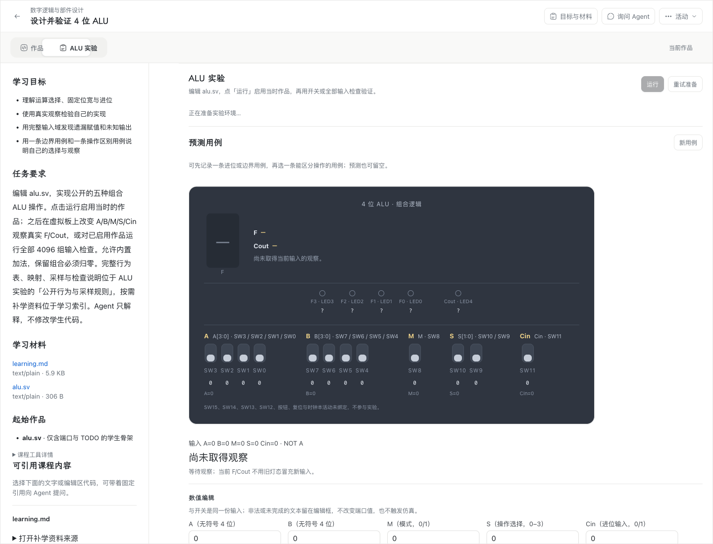
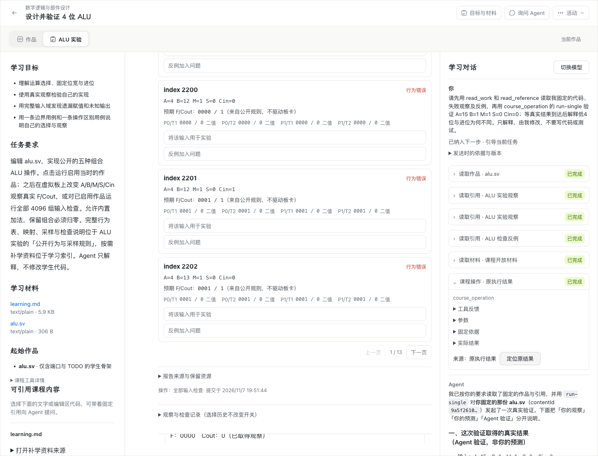

# WP07 #202：ALU 真实 Agent 辅导交付

本记录对应 [#202](https://github.com/paher-din/XunJie/issues/202)，[实施选择](specs/wp07-alu-tutoring.md)说明公开边界。2026-11-07 的本票组合验收独立登记，不使用 WP04 的旧验收代替。

## 实现与前置

独立工作树从 `wp07` / `087e7f9c7df5fdd593cd8f581537094ac0724858` 开始，实时核对 #198、#192、#193、#194 均 completed；通过正常 merge 集成固定已交付 `54216d99bd78829e8e1f9245a27561766b3a1bdd`，合并提交为 `95f4790e`。未集成 #195 的在途实现。

交付前正常合并远程已交付的 #212，合并提交为 `a91e252e`。该增量只涉及 SSH 恢复与其证据，没有修改 ALU、Agent 或产品界面；合并后完整工程验证通过。

| 前置 | 本票实际复用入口 |
| --- | --- |
| #198 通用 Agent 工具 | `createTeachingTools`、RunDriver、ModelGateway 原生工具往返、可信命令、浏览器 broker 与持久 Wait |
| #192 正式 ALU 运行 | 固定运行包、V3 执行契约、真实 Icarus Worker/WASM、不可变结果和资源 owner |
| #193 虚拟板和全量检查 | 原 ALU 组件、自由输入、`run-single`、`observe-enabled`、4096 组检查及反例 |
| #194 预测、解释与波形 | 固定用例/来源、解释修订、原 VCD，以及四种既有 ALU 语义引用 |

ALU 课程贡献把问题发送时的 HDL、获准输入、组件版本、运行包、预算和执行计划固定为原 V3 命令。实际执行 owner 再次校验权限及原资源，通用 Driver 不处理 ALU 信号或编译分支。没有新增编译器、结果 owner 或活动页面。

反例增加 `alu-counterexample` v1 引用，以真实输入 `index` 指向原检查及完整资源；已有观察、预测用例、比较解释和波形范围继续使用原 owner。引用验证会重读 primary 报告、反例资源和固定代码，拒绝伪造副本、错误索引、跨范围及损坏资源；读取历史不重新仿真。

Agent 验证在原组件和工具卡片中标明来源，可定位原结果；不启用新作品，不生成学生预测或解释，不把旧结论用于发送后的编辑。帮助限制应用于最终回答、过程、摘要、提问及展开参数，工具列表没有改代码、testbench、shell 或补丁能力。

## 工程验证

完整 `rtk bypass npm run verify` 通过：构建、类型检查、公共契约浏览器兼容、文档链接、全部本机 unit/server/tools 组均通过，测试未使用缓存。最后一轮于 2026-11-07 11:53 UTC 开始、11:57 UTC 完成，结果见[工程报告](evidence/wp07-202/engineering-report.json)。

本票相关公开 owner、Agent、引用与原生停止回归共 47/47 通过；完整 Web 回归含 86 文件、957 项。Standards / Spec 独立审查最终均 0 剩余发现，见[双轴审查](evidence/wp07-202/code-review.md)。

门禁中发现并修复两处既有 UI 测试的异步等待缺口，保留原断言；前置文档的两条本地产物链接改为保留路径和 hash 的文本记录。没有用放宽生产权限或执行预算处理验证失败。

公开边界回归包括固定依据、V3 可信来源、撤权围栏、浏览器身份、原命令恢复、资源保留和维护验证；帮助策略通过正式 HTTP/Agent 路径验证。原生停止回归同时核对物理进程退出与停止回执，未收到 ACK 时保持未知。

## 实际运行与桌面验收

最终候选的真实模型四路径均通过。每轮桌面验收先原子取得共享 `macos` / `windows` 目录锁，记录会话和时间，核对解锁、交互会话及前台，在结束和清理后释放；活跃锁不覆盖。候选的应用与分发摘要见[候选身份](evidence/wp07-202/candidate-provenance.json)，Windows 普通用户交互桌面见[实时预检](evidence/wp07-202/windows-desktop.json)。

| 路径 | 最终结果 |
| --- | --- |
| Apple Silicon Mac · 正式本机产品 · 桌面 Chrome | **10/10**，[报告](evidence/wp07-202/mac-product-report.json) |
| Apple Silicon Mac · 独立学校 HTTPS · 桌面 Chrome | **10/10**，[报告](evidence/wp07-202/mac-school-report.json) |
| Windows 11 x64 · 正式本机产品 · 桌面 Chrome | **10/10**，[报告](evidence/wp07-202/windows-product-report.json) |
| Windows 11 x64 · 独立学校 HTTPS · 桌面 Chrome | **10/10**，[报告](evidence/wp07-202/windows-school-report.json) |

组合路径覆盖：固定失败代码、真实观察、学生用例及 VCD 范围、检查反例 → 模型读固定依据并请求真实验证 → 根据原结果解释 → 学生自行修改 → 新的真实观察；另验正常输入、关页后的原 Wait、丢结果确认后的原命令续送、工具输出指令与重开后保留。

真实模型回答与工具身份保留为摘录：[Mac 本机](evidence/wp07-202/mac-product-run-5.json)、[Mac 学校](evidence/wp07-202/mac-school-run-5.json)、[Windows 本机](evidence/wp07-202/windows-product-run-5.json)、[Windows 学校](evidence/wp07-202/windows-school-run-5.json)。关页注入在旧页关闭前持续阻断 claim 回执，并断言原命令尚未开始；严格边界的最终实跑见 [Mac 学校](evidence/wp07-202/mac-school-page-reopen-original-claim.json)与 [Windows 本机](evidence/wp07-202/windows-product-page-reopen-original-claim.json)。丢结果确认后仍核对原命令，见 [Mac 学校](evidence/wp07-202/mac-school-result-reply-loss.json)与 [Windows 本机](evidence/wp07-202/windows-product-result-reply-loss.json)。

本机 VPN 的 DNS 把供应商域名映射到保留测试地址，生产连接策略按预期拒绝。授权的本机模型验收使用只转发原字节、验证 `api.deepseek.com` TLS 主机名的临时中继，模型输出由真实供应商产生；没有改动产品连接策略。学校运行于独立 Linux 节点，浏览器直接连接其公网 HTTPS，校验 CA 与精确 SPKI，不通过本机代理或 SSH 隧道。学校模型直接连接供应商。学校候选独占 9443；本次临时规则只放行客户端 `/32`，收尾撤销并核对原规则集合。原 #188 实例的数据、配置及监听不受本票更改。

原生输入另做本票新跑回归，使用真实操作系统候选窗、选择、提交、取消与焦点切换；不把 Playwright 填写文字当作系统输入法证据。Mac / Windows 均 **16/16**，分别见 [Mac 报告](evidence/wp07-202/mac-native-input-report.json)、[Windows 报告](evidence/wp07-202/windows-native-input-report.json)。该回归复用既有输入法验收脚本，属于本票的新运行；实际候选窗见 [Mac](evidence/wp07-202/mac-native-candidate.png)、[Windows](evidence/wp07-202/windows-native-candidate.png)。

Windows 学校的一个早期轮次在学生修改后的再次观察中触发真实编译预算中止，保留原 request、原代码及 `confirmed/failed`，没有当作成功观察，见[预算中止记录](evidence/wp07-202/windows-school-budget-abort.json)。重跑使用隔离验收账号。早期学校首次准备超时及一次候选同步遗漏隔离助手的失败也保留为未通过轮次，后者补齐同候选助手并核对固定 hash 后，原生输入 16/16 通过。

Windows 本机的一个补充轮次因供应商 TLS 新连接超时以 `upstream-http` 失败，没有计为通过；最终独立轮次 10/10。准备超时和该失败见[早期轮次](evidence/wp07-202/earlier-attempts.json)。慢学校网络还暴露探针第二次 claim 意外放行，原执行如实确认为取消，见[注入回归记录](evidence/wp07-202/page-close-injection-regression.json)；修正为持续阻断后，Mac 学校的最终严格关页轮次 10/10。探针未增加隐藏模型重试或放宽产品预算。

## 界面变化

在已确认的 ALU 组件内增加“反例加入问题”、Agent 验证来源及原结果定位，便于学生对照实际依据。布局、虚拟板、编辑器、导航和预测/解释入口沿用原实现；Agent 的观察与学生独立预测分别呈现。板外数值输入间距对齐设计规范。

| 修改前：本票开工时实际正式活动 | 修改后：最终候选实际正式活动 |
| --- | --- |
|  |  |

## 交付与限度

工程、实际仿真、Agent 行为、浏览器/部署分别登记。4096 组检查仅是公开行为检查，不代表学习收益、学生掌握或教师接收。本票未评估教学效果。

一次性学校环境已通过 owner API 停止、按固定环境身份删除；临时 9443 规则已撤销，原三条安全组规则逐项一致，原 8443 监听保持不变。Windows 的本票目录、定时任务和已确认空闲的临时目录已清理；本地候选包、归档、证书私钥及本票私有账号副本已删除，保留必要公开证据与 owner 永久锁。详见[清理回执](evidence/wp07-202/cleanup.json)。用户原始私有账号文件未改动。

交付分支为 `wp07`，固定提交与远程 SHA 核对结果登记于 [#202 的完成记录](https://github.com/paher-din/XunJie/issues/202)。本分支推送没有触发仅覆盖 main/PR 的 hosted CI，不声明其通过；本机完整验证和真实桌面验收结果如上。
