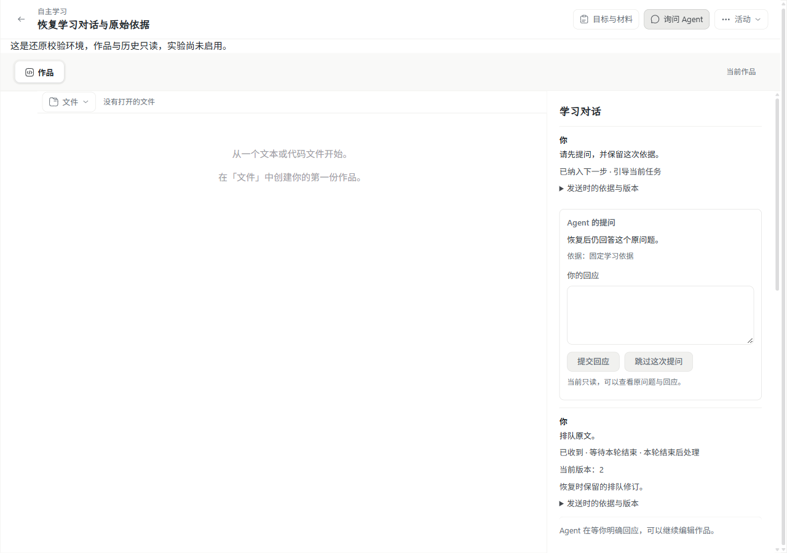
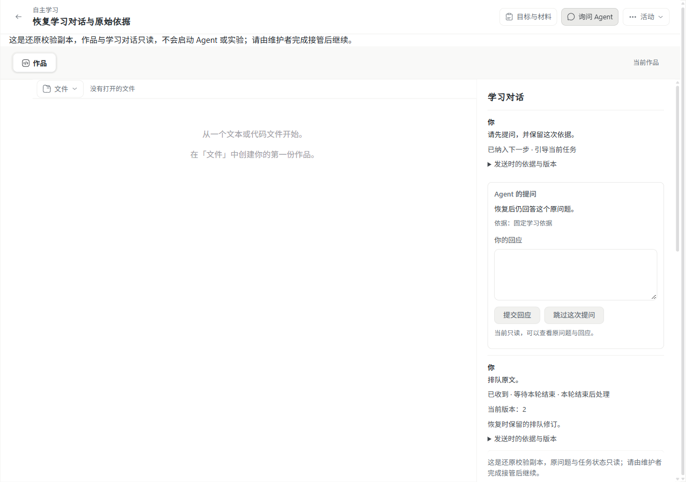

# #204 学习对话的备份、还原与接管

本次在同一 `wp07` 实施，不创建 PR。来源为 [#204](https://github.com/paher-din/XunJie/issues/204)，方案见[实施选择](specs/wp07-conversation-recovery.md)。Mac 与真实跨机验收由使用已有环境的执行者在新票 [#212](https://github.com/paher-din/XunJie/issues/212) 接手；本机多安装不计为跨机。

## 实现

Agent owner 新增自己的版本化维护清单，覆盖会话、请求、不可变快照、Run/步骤、命令、Wait、学生问题/回应、输入修订/采用、控制、模型切换、预算与分片。20 张表分别记录数量与内容摘要；资源同时核对引用身份及原字节。运行层只装配 owner 接口，不读取或修改领域表。

正常组合和独立 Agent 使用同一清单。独立还原通过真实 owner 重新读取记录和资源核对，损坏清单拒绝，未知必需版本报告不兼容。保留受支持旧通用维护材料及已发布迁移；日志 v1 新增显式可忽略扩展外壳，原 payload 保留，必需未知事件仍拒绝推进。

沿用正式 CLI 和现有恢复状态机：先关准入/派发、分别排空各 owner，再导出；物理调用与真实执行边界由各自 owner 确认。隔离副本不推进，目标正式接管才退休源安装、撤销旧资格并启用新命名空间。未结身份、Wait、修订和预算沿原规则继续，不用重放补历史。

独立 Agent 的接管增加运行层安装继任证明、固定活动路由核验及 `reconnect`。真实学习数据 owner 在新授权签发时附加执行授权历史，保留原 origin、命令和回执；同一当前安装仍有已登记有效授权时保留任务，全部失效后按原协议清理。清理前锁定并重读授权，旧扫描不能取消刚完成迁接的命令。接收方在关闸期间一次完成源安装全部服务的撤权和继任登记；目标启用前清除旧出站连接，重复接管不会删除后续重连。

已验证阶段的失败可继续重试。完整绑定备份及源/目标安装的正式接管重试可恢复开放；失败的手动 fence 重试继续保持关闭，需维护者显式恢复。独立 Agent 本次要求稳定 `publicEndpoint`，主机切换通过该地址的实际路由完成；`reconnect` 只轮换凭据，不能更换固定 owner、能力或传输描述。

## 界面变化

仅修正既有只读工作区和对话提示：原先在还原副本仍提示“可以继续编辑作品”，现在明确学习对话只读、不会启动 Agent/实验，并指向维护者完成接管。沿用原布局和设计 token，避免学生把历史副本当作已启用的工作区。

修改前后均由真实运行页面、桌面 Chrome 截取：

| 修改前 | 修改后 |
| --- | --- |
|  |  |

## 验证记录

运行平台为 Windows 11（build 26200）、Node 24.21.0、原生 PostgreSQL 18.6、桌面 Chrome 157.0.8103.38。最终产品实现提交为 `3e77136e3c9e99d2cd33ba81dd49c56c9cd8e581`；后续提交补验收工具、证据和交付说明。模型 transport 使用合成上游；实际使用生产 HTTP、owner、PG、资源及发布的 WP03 算法，没有读取或调用付费模型密钥。

### 工程

| 检查 | 实际结果 |
| --- | --- |
| 最终构建及全工程类型检查 | `product-runtime:test`、`typecheck` 通过；完整 Windows full 包另建成功，未复用旧 Web 输出。 |
| 事件协议 | 原可忽略扩展的 payload 和额外字段原样保留；未知必需事件/版本拒绝，1/1 通过。 |
| 正式恢复及执行清理 | 最终连续批次 12/12 通过、0 跳过：五项正式恢复与七项真实执行清理，约 428 秒。 |
| 独立 Agent | 学生 Wait 与真实工具 Wait 2/2 通过，含接收方验证失败后重试、并发新授权、凭据轮换、撤销未使用授权、重连后重复接管和接收学校无关休眠问题保留。 |
| 运行层接收端 | 6/6 通过，覆盖手动/正式重试边界、真实撤权、旧安装拒绝以及接收方备份后的永久退休事实。 |
| 双轴代码审查 | [Standards 0、Spec 0 项未解决](wp07-204-code-review.md)，静态审查不代替运行验收。 |

正式恢复五个场景分别核对学生提问及修订队列、真实物理调用仍未知的暂停 Run、原生完整结果已保存但未关联及封存/新段、坏清单和必需格式拒绝、WP03 原命令接管及未确认浏览器执行阻止备份。预算与实际用量保持原事实；当前作品已改变时仍沿原快照继续。执行清理七个场景另核对普通撤权、活动关闭、旧授权扫描竞态、批次公平性和实际物理 owner 的停止确认。

完整工程发现清单于 `2026-11-06 21:54 UTC` 全部结束，约 26 分钟，退出码 1；167 个调度项中 **145 通过、22 失败、0 未执行**，没有宣称全量通过。Web 全组计一个调度项，调度项不与用例数相加，日志中的个别跳过也不计为通过。

| 原始完整工程组 | 通过调度项 | 失败调度项 |
| --- | ---: | ---: |
| prepare | 4 | 0 |
| build:test | 1 | 0 |
| unit（含 Web） | 26 | 3 |
| server | 86 | 2 |
| tools | 28 | 17 |

完整检查的类型检查、正式构建、14 个浏览器安全契约出口及受版本控制文档检查均通过；229 份 Markdown、2080 个本地目标，0 链接失败。最终本票文档另行按实际改动清单检查。

22 个原始失败中，本票的手动 fence 兼容问题修复后接收端整文件 6/6 通过；旧开发工具的“仓库外”用例因本轮 `TEMP` 位于仓库内而失败，改用仓库外的专用临时目录后整文件 15/15 通过。**其余 20 个调度项仍未通过**：包括 Windows 软链权限、私有文件校验、本地通信冲突、旧 Bash 路径处理、旧云端/复现包用例的断言或连接问题。相关旧测试文件本次未修改；没有对其余每项另做基线复跑，因此不把“范围外”自动当成已证实的环境问题。失败逐项及后续复验见[分项证据](evidence/wp07-204/verification.json)。

默认清单不包含 `.runtime.test.*`，以上原生场景单独显式执行。完整检查使用独立源码和 `npm ci` 副本，未重装工作区依赖；所有改动源码核对了 SHA-256。原 `verify` 批次曾被失败用例遗留句柄阻塞，终止记录保留；一次早期快照复制遗漏已提交源文件，整批作废，未计为有效验收。后续按同一正式发现清单逐项运行，文件直接记录输出，并使用 Node 的 `--test-force-exit` 结束已完成测试文件，断言仍实际执行，结果不缓存。

### 恢复、部署与 Chrome

- 普通 Web 的正式 CLI/Chrome 五阶段通过：安装、只读历史、只读页面禁用回应、正式接管及旧客户端拒绝、原回应和 FIFO 继续。
- 最终新建完整 Windows 包经包内 Node、PG 和 CLI 执行同一五阶段，5/5 通过；合成模型总调用 3 次，原 Run 和队列对应的后继 Run 均完成，测试环境正常停止并清除。最终页面等待修订输入实际显示为已采用后截图；见[产品包报告](evidence/wp07-204/chrome-package.json)。
- 独立 Agent 经真实 HTTP、固定逻辑 owner 和稳定地址恢复，桌面 Chrome 提交对原问题的明确回应，原 Run 完成；同进程轮换凭据和重连后的重复接管通过，环境清理完成。见[独立 Agent 报告](evidence/wp07-204/chrome-independent.json)和[实际页面](evidence/wp07-204/independent-agent-active-win32.png)。这属于同机多安装，不能代替真实跨机。
- 本任务的 Apple Silicon Mac、完整 darwin-arm64 包及真实 HTTPS 跨机学校/混合/独立 Agent 验收未执行，交接新票 [#212](https://github.com/paher-din/XunJie/issues/212)。由持有已有环境的人执行，不搭建 Mac 环境，既有 #210 结果不充当 #204 验收。

### 教学效果与失败记录

本次只验证恢复后保留原学习依据、明确回应及操作顺序。真实 WP03 算法计算均值 `83.33333333333333`，原命令/Wait/执行身份及资源结果未重建；它证明工程路径可用，不证明学生理解、引导质量或学习效果提升。未执行真实学生研究。

失败原件保存在本机 `.verification/wp07-204/`。早期维护清单缺口、未知状态误分类、独立安装继任/凭据和重复接管问题有先失败再修复的记录；授权扫描竞态也先在真实执行中复现。一次最终五场景批次在重新启用时遇到 Windows 进程身份查询失败，单独复跑该 WP03 场景 1/1 通过，原失败没有覆盖。较早的宽范围原生回归出现超时/旧夹具不兼容并遗留句柄，已终止，不宣称整批通过。

失败测试的个别未确认边界按安全约束拒绝正式停止，失败记录保留；核对确属本票后，单独停止其测试进程和一次性 PG，不把应急清理计为正式停止通过。正常 Chrome 两条路径清理结果分别记录。最后核查本票无残留运行进程，一次性数据库/密钥目录、隔离工程副本与旧候选包已删除，回收约 2.3 GiB。原开发实例仍运行；原工作区、资源缓存和无关资料保留。最终可复查的 Windows full 包保留在本机 `.verification/wp07-204/product-win32-x64-final`，原始日志和审阅证据也保留。

## 复跑入口

使用 Node 24.21.0、原生 PostgreSQL 18.6、已有桌面 Chrome，在独立临时目录执行。`XUNJIE_PRODUCT_POSTGRES_BIN` 指定实际 PG bin；`TEMP`/`TMP` 指向已允许的专用临时目录。仅控制合成外部模型 transport，使用真实产品、owner、PG、资源和 WP03 发布算法，无付费模型要求。

```powershell
node scripts/build.mjs product-runtime:test
node --test --test-force-exit packages/contracts/test/teaching-event.test.ts
node --test --test-concurrency=1 --test-force-exit apps/server/tests/agent-deployment-cleanup.runtime.test.mjs apps/server/tests/teaching-agent.recovery.runtime.test.mjs
node --test --test-force-exit apps/server/tests/teaching-agent.independent-recovery.runtime.test.mjs
node --test --test-force-exit packages/product-runtime/test/recovery-connections.test.mjs
node scripts/probe-conversation-recovery.mjs
node scripts/package-product.mjs --platform win32-x64 --profile full --cache <资源缓存> --out <新的候选目录>
node scripts/probe-conversation-recovery.mjs --package <新的候选目录>
```

Windows 原生会话清理测试还需 `XUNJIE_NATIVE_SESSION_HELPER` 指向实际产品包的 `resources/native/windows-session.exe`。独立 Agent 的可见 Chrome 场景可设置 `XUNJIE_RECOVERY_CHROME=1`，只运行 `--test-name-pattern="original student Wait"`；真实跨机另按 #212 的已有环境执行。

Probe 用正式 CLI 安装、备份、独立只读还原、接管两次及停止，在 Chrome 提交对原问题的明确回应；报告位于 `XUNJIE_RECOVERY_EVIDENCE_DIR/report.json`，截图在同目录。备份密钥、数据库与测试账号仅在私有一次性目录，停机后清除；浏览器未同步草稿、临时流、编译缓存和活进程内存不被计入服务备份。原始本机日志、完整发现清单及源码摘要由分项证据记录，失败和未执行项不计通过。
