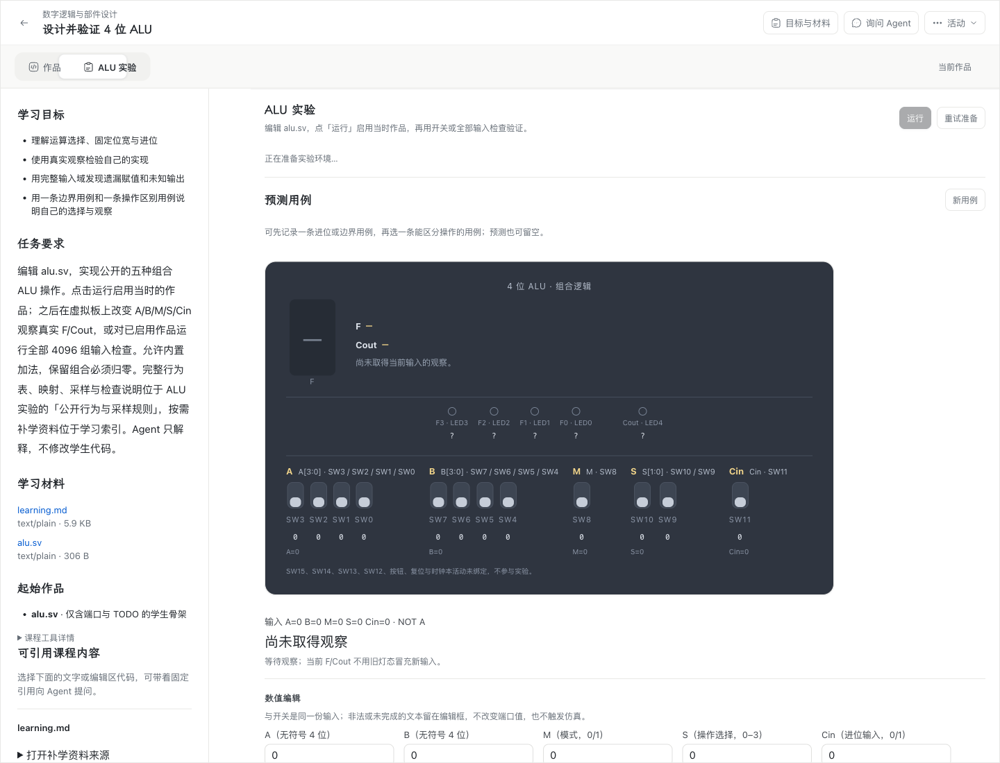
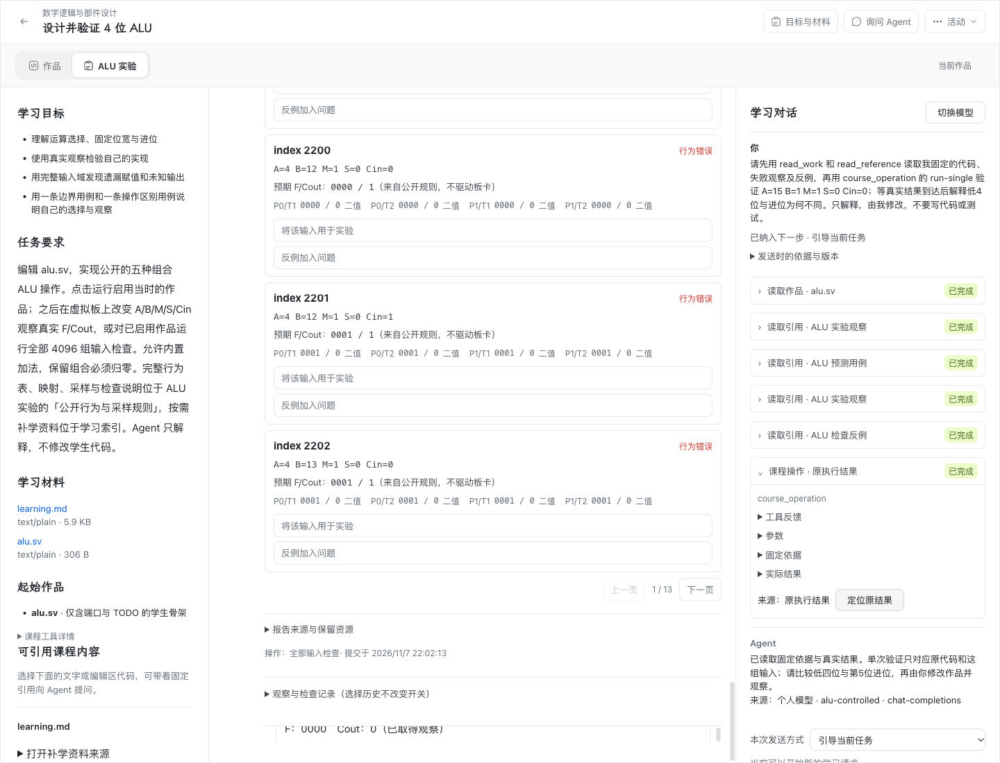

# WP07 合入 main 前的整合与复验

2026-11-07，Robert 授权在 `wp07` 合入已完成 WP04 的 `main`，然后提交 `wp07 → main` PR。本记录只登记这次组合复验；各实施票的平台与真实模型结果仍对应各自候选。

## 固定输入与合并裁决

- 原 `wp07`：`9b26b6d895eeadca862d97bca8a9e2f073bce942`。
- `main`：`9d41236d7e76a887c66f5376497ebbad0e257a35`，已合并 [PR #213](https://github.com/paher-din/XunJie/pull/213)，包含最终审查修复和 WP08 范围文档。
- 正常合并提交：`0794a8ba`；测试等待修正：`6dffa3c`。保留两边提交历史。

| 冲突位置 | 最终行为 |
| --- | --- |
| `AluCases.tsx` | 合并准确的原引用定位、隐藏来源登记与 Agent 验证来源、原执行定位属性。 |
| `components/alu-experiment/package.mjs` | 保留组件 v4 / stateVersion 3 / runtime 0.3.1；带帮助策略的课程采用新导入请求 `…0204`、发布 `…0205`，不复用 WP04 `…0185/0186` 或原 WP07 `…0202/0203`。 |
| `learning-data/executions.ts` | 保留 Agent 可信接受、授权和回收，同时提供 owner 核验的 `hasReceivedBrowserCommand`。 |
| `product-runtime/learning-entry.ts` | 同时装配 Agent 授权继任、依赖服务、paired 模型来源与浏览器维护准入。 |
| 三份模块／验收索引文档 | 保留 WP07 交付、WP04 恢复与 WP08 范围入口；既有包摘要保留为文本。 |

原 runtime 0.3.0 目录与 `main` Git tree 完全一致，包括许可证原字节。本次没有重新编译工具链或更改已有组件定义。课程导入继续执行 WP07 已确认的显式、版本化 `helpPolicy` 要求；未声明策略的旧课程须显式发布新版本，不在读取时补默认策略。

## 本次工程与运行验证

完整结果见[工程汇总](evidence/wp07-main-integration/engineering.json)。

| 边界 | 最终结果 |
| --- | --- |
| 全工程类型检查 | 通过。 |
| 完整 `rtk bypass npm run verify` | 2026-11-07 14:00 UTC 开始，所有阶段通过；unit 34、server 90、tools 45 个任务，Web 89 文件、991/991 测试。 |
| 真实 PostgreSQL、Agent、ALU、执行及存储 owner | [73/73](evidence/wp07-main-integration/owner-runtime.log)，0 跳过。包括两个固定 ALU 发布及其显式帮助策略共存。 |
| 学习对话与独立 Agent 恢复 | [7/7](evidence/wp07-main-integration/recovery-runtime.log)，0 跳过。原学生／工具 Wait、授权继任、队列修订、未知物理调用、原结果封存及未确认浏览器阻止备份。 |
| 新 darwin-arm64 full 包 · 桌面 Chrome · ALU 辅导 | [10/10](evidence/wp07-main-integration/chrome-tutoring.json)。真实产品、PostgreSQL、Worker/Wasm、原引用及命令；仅模型 transport 受控。 |
| 同一候选 · 桌面 Chrome · ALU 备份与恢复 | [9/9](evidence/wp07-main-integration/chrome-recovery.json)。原身份结算、资源负例、隔离零 Worker／零业务写入、丢接管确认重试、源退休和旧客户端拒绝。 |
| 合并增量双轴审查 | Standards 0、Spec 0 剩余发现；后续测试／探针增量复核仍为 0。范围为 `9b26b6d8...HEAD` 的 main 整合，逐票既有审查继续保留。 |

新完整包使用 Node 24.21.0、PostgreSQL 18.6，应用及分发摘要见工程汇总。两轮桌面验证均通过原子共享锁，核对解锁与前台，并在 finally 释放。完整工程验证之后只修改恢复测试装载器和探针，分别由上述原恢复用例、实际桌面探针及语法检查验证。

本次没有重新运行 Windows、学校 HTTPS 或真实外部模型的完整矩阵；这些证据见 [#202](wp07-202-alu-tutoring.md)、[#203](wp07-203-agent-deployment.md)、[#208](wp07-208-mac-acceptance.md)、[#209](wp07-199-mac-acceptance.md)、[#210](wp07-210-mac-acceptance.md)、[#212](wp07-212-mac-cross-machine-acceptance.md)等各票记录。没有把旧候选结果称为本次 HEAD 的整矩阵复跑。教学效果未评估。

## 失败与修正

[早期轮次](evidence/wp07-main-integration/earlier-attempts.json)未计为通过。首轮完整工程因测试夹具固定等待 `submitted.length === 1` 失败；主线新增连续两次比较后，该条件已过期。删除重复等待，保留 `compare()` 对每次提交数增加 1 的有界等待及全部只读／零重跑断言；组件 11/11 及最终完整验证通过。

独立 Agent 工具 Wait 恢复两次稳定失败于验收助手的 `data:` 模块相对导入：单文件 TypeScript 转译未包含生产算法的 `./errors`。改为 esbuild 打包真实算法及其依赖，继续执行同一发布 Wasm，原 7 个恢复用例全部通过。没有改变生产恢复状态机或代造计算结果。

两次桌面恢复探针在六项完成后因旧文案或隐藏工具选择器失败。最终先打开 ALU 工具，再核对只读状态；禁用操作、零 Worker、零业务写入和原字节断言保留，9/9 通过。

## 实际界面与清理

沿用现有布局，合并主线的准确定位和完整历史与 WP07 的 Agent 来源、工具记录及原结果定位，便于学生核对真实依据。前图来自 #202 开始前的实际页面，后图来自本次合并候选的实际 Chrome；后图的模型 transport 为受控工程验收，不作为真实供应商证据。

| WP07 辅导接入前 | 本次合并候选 |
| --- | --- |
|  |  |

本票的一次性产品包、载荷、恢复副本、备份、临时账号与密钥配置均已清理，owner 永久根锁保留；未修改共享学校或其他工作树环境。失败夹具遗留资源先核对所属工作树，再通过 owner API 停止和删除，见[清理回执](evidence/wp07-main-integration/cleanup.json)。
