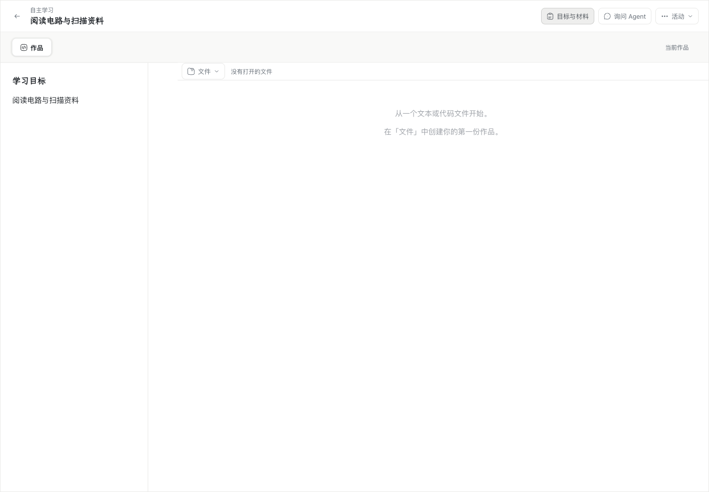
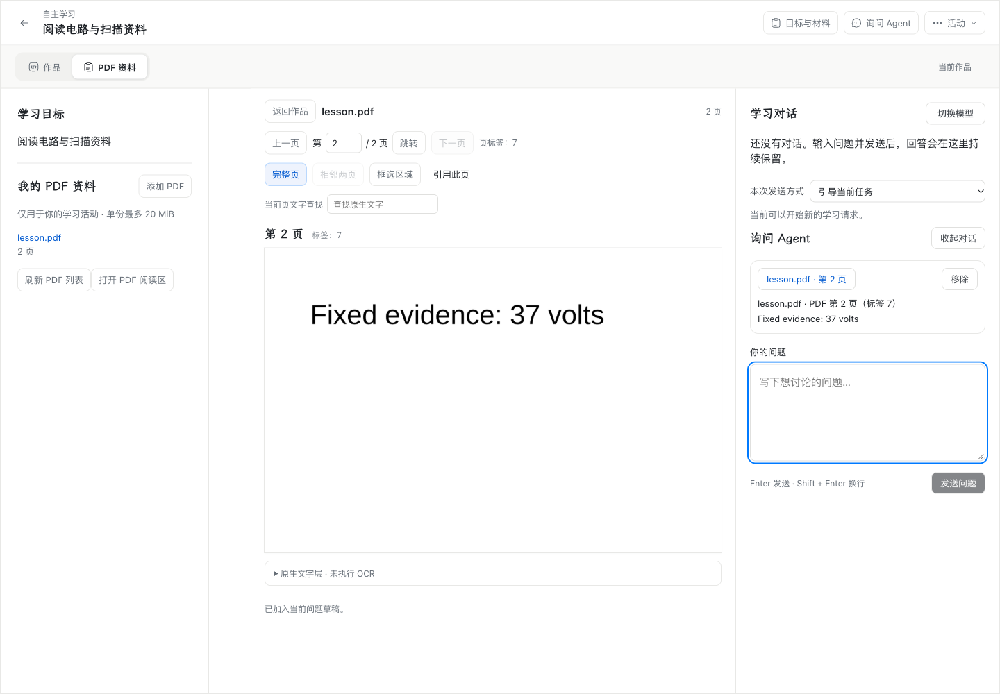

# [WP08：PDF 添加、按页阅读与固定引用](https://github.com/paher-din/XunJie/issues/218)

规范为 [WP08：PDF 添加、按页阅读与固定引用](https://github.com/paher-din/XunJie/issues/218) 及母票 [WP08：Agent 能力、上下文与扩展](https://github.com/paher-din/XunJie/issues/214) 的 PDF 适用条款。基线为 `cb104e33604cbfcb8c5c4f294dd5c745e723834c`；本分支只交付 PDF，不合并其他 WP08 分支。

## 学生使用与界面变化

在原活动「目标与材料」中添加个人 PDF，或点击当前获准发布的课程 PDF；阅读器使用原中心工具区。学生可切换实际页序、读取相邻两页、框选区域并将固定依据加入现有问题草稿。引用后焦点回到问题输入框；原作品、材料、讨论区和模型设置入口保留。

这次增量增加了材料添加、PDF 页图阅读及来源定位，目的是让图表和扫描页可实际阅读，而不要求学生复制文字或理解 Agent 内部过程。页图与原生文字层分开显示；当前页查找只搜索原生文字层，不声称执行了 OCR。模型路线没有已核验图像能力时只返回文字及明确限制，不自动更换模型。

实际运行对照：

| 修改前 | 修改后 |
| --- | --- |
|  |  |

更多真实截图、各项验收边界与可复现命令见[证据索引](evidence/wp08-218/README.md)。工程通过与固定模型案例不代表学生掌握或教学收益。

## 身份、读取与保留

- `learning-data` 在迁移 23 中拥有原件与固定读取记录。原文件以文档 UUID、SHA-256、活动/主体范围和上传请求身份保留；同名上传创建另一个文档，不更新旧版本。
- 外部实际页序从 1 开始。印刷页码只作为标签；固定读取保存请求页集合、成功/失败页、原生文字、PNG、副本摘要及转换参数。区域坐标为旋转后 CropBox 的左上角归一化坐标，`x/y/width/height` 均相对于可见整页。区域图片只含选区，文字仍来自整页，结果明确说明这一点。
- 上传前浏览器 IndexedDB 保存原文件和请求身份。丢回执后核对原文档再继续；服务端先保存原件，再解析。未完成、损坏、加密及限额结果不显示为 Agent 已读。
- `pdf-pages` 语义引用复用唯一可靠草稿、固定动作和资源 pin。所属 owner 校验保存的文字/页图、摘要、活动归属和精确范围；不接受浏览器伪造副本。不完整页集合不能作为完整引用保存。
- `read_reference`、`read_pdf` 和 `find_pdf` 复用原工具 prepare/dispatch/reconcile/stop 边界。查询明确区分已搜索页、无文字页、不完整页和截断；命中位置使用 UTF-16 code units。原件、实际使用的派生件和引用参与业务备份/恢复验证。
- 完整读取/查找结果与模型投影分开保留，投影按 Gateway 实际文字上限裁剪并标明范围。`read_pdf_text` 以当前已选择引用限定文档及摘要，按 UTF-16 范围继续读取固定 `readingId` 的原生文字；不能借用其他文档的读取，也不重新转换或执行 OCR。
- 回答和工具记录的「定位来源」打开固定 `readingId`。恢复仅重读已保存内容，不再次渲染补造模型原输入；课程资格仍在原 owner 核验，撤权不会切换到其他来源。
- 新模型段复用既有 RunDriver：无新 steering 时恢复已采用的问题；有新方向时按原顺序采用。原页图引用从已结算命令恢复，不重复派发读取；Command、Wait、预算及未知效果仍使用原事实。

## 渲染与分发

PDF.js `6.5.438` 与 `@napi-rs/canvas 1.1.0` 在资料宿主的独立子进程执行真实转换。子进程仅接收固定字节和随包资源，禁止网络请求、系统字体、脚本和 XFA；无 OCR。

| 限额 | 当前值 |
| --- | --- |
| 原文件 / 文档页数 | 20 MiB / 200 页 |
| 一次读取 | 1–2 个不同的实际页序 |
| 转换并发 | 1 个执行、最多 2 个等待；等待计入 30 秒期限 |
| 子进程 JS heap | 256 MiB |
| 源图片 / 输出像素 | 16 MP / 2048 × 2048 |
| 输出 PNG | 每页 ≤256 KiB；长边依次尝试 2048、1536、1024、768、512 |
| 原生文字 / 子进程响应 | 每页 128 KiB / 每次 2 MiB |

超时、损坏、加密、越界页、限额和单页失败分别返回；已完成页可独立保留。缩放、旋转、CropBox、区域和引擎版本记录在实际页图旁。图像按现有 Gateway 的 PNG、尺寸、字节和数量契约发送；小字不足时说明限制，可选择更小区域读取。

产品包携带 PDF.js worker、CMap、标准字体、WASM、ICC 与目标平台 canvas 原生模块；保留 Apache-2.0、MIT 及字体/codec 等独立许可、对应源码链接和文件摘要。Windows 路径用 `pathToFileURL` 生成以 `/` 结尾的资源目录 URL，不依赖开发者工具或系统 PDF 程序。

## 验证

公共入口测试使用真实生产 owner、PostgreSQL、PDF 转换及可靠动作；只有模型 transport 和故障时点受控。真实供应商、产品包、Chrome、跨机与维护另行留证，详情见[证据索引](evidence/wp08-218/README.md)。没有运行教学效果研究。
