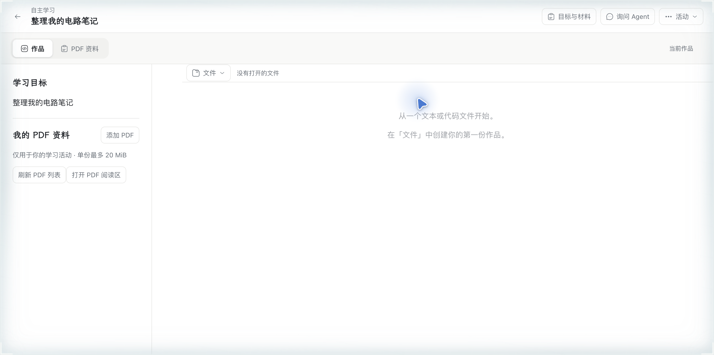
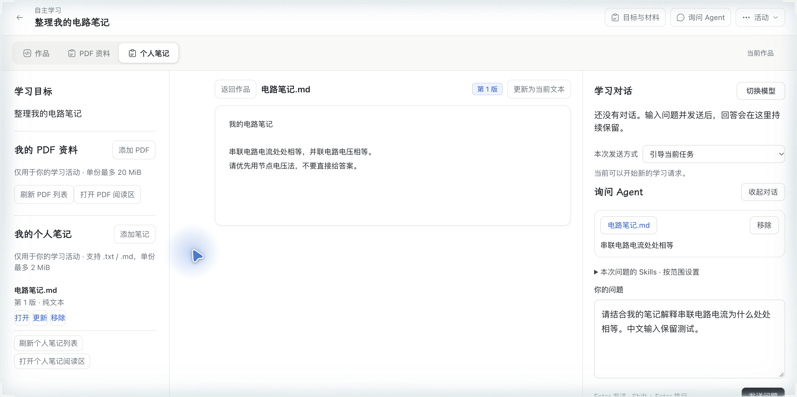

# [WP08：个人资料、相关材料检索与记忆读取](https://github.com/paher-din/XunJie/issues/219)

规范为 [#219](https://github.com/paher-din/XunJie/issues/219) 及母票 [#214](https://github.com/paher-din/XunJie/issues/214)；基线为 `39d234cf`。本票只交付个人文本资料、统一检索与明确事实读取，不包含 MCP、Plugin 或依赖 MCP 的 Apps。

## 学生使用与界面

原活动「目标与材料」增加个人笔记列表和编辑器：支持 `.txt` / `.md` 与粘贴文本，正文上限 2 MiB、名称上限 240 字符。保存、更新、移除先在本机可靠请求分区留底，再按原 `requestId` 核对服务回执；同名材料按 `materialId` 区分，更新创建不可变新版本，移除只隐藏当前列表、不删除固定版本。个人笔记可在原工作区阅读，正文选中后进入既有问题草稿，引用固定 `materialId + version + sha256` 与 UTF-16 范围。

| 修改前 | 修改后 |
| --- | --- |
|  |  |

更多截图与复现命令见[证据索引](evidence/wp08-219/README.md)。

## 数据、版本与引用

- `learning-data` 的迁移 24 `personal-text-materials` 增加 `personal_materials` 与 `personal_material_versions`。原字节按材料版本和资源 pin 保存；UTF-8 严格解码，损坏、非文本或超限拒绝。
- 更新要求 `expectedVersion`；过期版本返回 409，不覆盖新版本。保存/更新/移除回执都必须核对原请求身份、材料身份、版本和摘要；未知回执可沿 `requestId` 查询。
- 问题草稿引用只接受本活动、本主体、本空间的固定材料版本；服务端重读原字节、摘要和精确文本范围，不接受浏览器伪造副本。被移除版本仍可读，但不再进入当前材料列表。
- `read_reference` 保留既有范围副本；新增 `read_personal_material` 工具按固定 `materialId + version` 读取任意 UTF-16 范围，解决搜索命中在引用选区之外时无法回读原件的问题。

## 检索与事实读取

- `material-search` 每次按当前活动、主体、空间、课程和明确选择范围重读来源，不建立可过期索引：课程发布文本、个人固定版本、PDF 已保存原生文字层、明确选中且启用的 Skill UTF-8 附件。
- 课程材料由发布版本和 `releaseId` 约束；个人材料按草稿选定 `materialId/version` 固定；PDF 只使用固定 `readingId` 的原生文字；Skill 附件由 `skillId/version/path` 和 `skill_read` 复核。未授权来源不返回标题、片段或缓存。
- 结果分别报告 `searched`、`no-hit`、`not-indexed`、`no-text`、`partial-failure`、`no-access`、`missing`，并记录覆盖数量、实际搜索字符数、页/行位置、读取方式和固定来源。空文本是 `no-text`，不是已搜索后的无命中。
- `read_student_facts` 从 `teaching_student_facts` 读取学生明确表达的第一人称偏好/指令，保留原事件、时间、内容版本、作用域、复核/修正/撤回链。同活动默认隔离；同课跨活动按活动或课程范围读取；跨课只复用全局偏好；个人活动只在文本明确“继续这个目标/同一主题”时读取同目标的其他个人活动事实。缺失不伪造确认，不写学习画像或掌握判断。
- `search_materials` 与 `read_student_facts` 的工具结果进入同一教学步骤上下文清单、原工具记录、回答来源和重启重读；重启只读已保存结果，不重新搜索。个人材料、事实和资源已进入 owner 的恢复校验。

## 标记与范围

本轮个人资料仅用于当前主体/空间/活动；不自动进入教师投影、其他学生上下文、课程发布或全量会话共享。未实现 MCP、Plugin、Apps、向量索引和 WP11 画像写入；这些不在本票范围。搜索成功、事实读取或模型生成回答均不构成学习判断或教学效果证据。

## 验收说明

工程检查、浏览器验收、本地模型链路和教学效果分别记录，不能互相替代。浏览器证据和可复现命令见[证据索引](evidence/wp08-219/README.md)。
