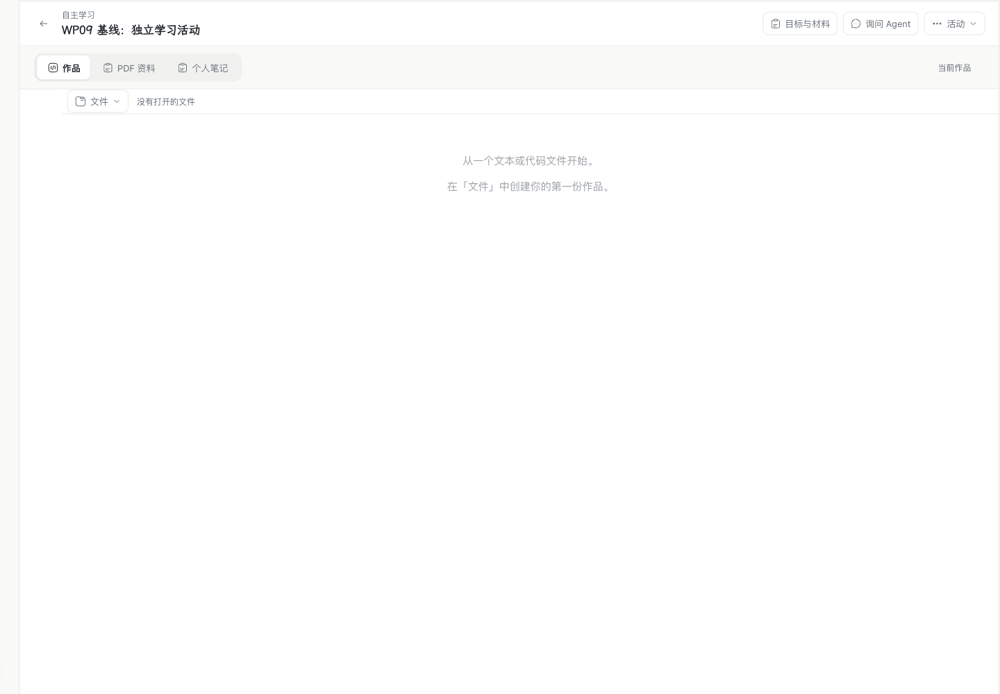
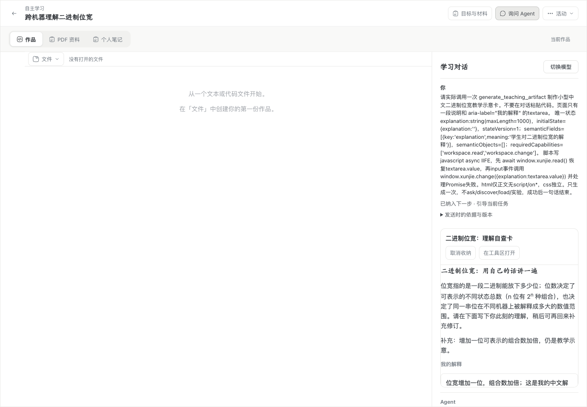

# WP09：可交互教学内容实施与验收

规范：[WP09：可交互教学内容](https://github.com/paher-din/XunJie/issues/224)。实施基线为 `main@58c7cc5fee18bc3baf6ab874467fba6d57de4e17`。本记录区分设计、实现和实际验证，不复制 issue 的动态实施状态。

## 实现与所有权

正式学习活动增加了活动内教学产物：原对话中的静态渐进预览、检查后的可交互卡片、原中心工具区、收纳与再次打开。没有建立另一套产品壳。独立学习不要求课程；ALU 页面复用原课程能力和宿主真实结果区。

- `learning-data/teaching-artifacts.ts` 持有不可变资源、版本、候选、检查、采用、收纳和稳定请求回执。状态仍由 WP02 工作区持有；内容绑定与状态使用同一事务及工作区条件提交。
- 既有 TeachingAgent/ModelGateway 持有原 Run、Command、attempt、请求快照和预算。`generate_teaching_artifact` / `read_teaching_artifact` 来自同一版本化能力贡献，三协议 HTML 增量只作有界进度，不派发半截参数。
- Web 在独立无脚本预览和隔离正式 iframe 之间切换。宿主核验固定资源，检查用独立样例状态；正式视图完成状态读取后才开放交互。普通控件变化只保存状态，明确回应、引用和实验使用原公开动作。
- 兼容修订保留语义字段和采用等待期间的新输入；新结构必须接受旧结构的整个输入范围。不能证明兼容时保留原页并另开实例，旧引用、结果及资源保持固定版本。
- 未收纳状态、采用与收纳未知回执沿现有 IndexedDB/可靠动作保护。收起视图保留挂载和输入，中心页与内联页保持一个可编辑实例。只读还原不产生客户端恢复写入。

渐进片段处理局部复用 OpenIntelligentUI，锁定提交与 MIT 许可保留在 [partial-html.ts](../../apps/web/src/teaching-artifacts/partial-html.ts)，许可正文也进入实际 bundle。MCP/Plugin/Apps、Flights 和规范列出的后续 WP 继续暂缓。

## 验收映射

以下状态均需实际命令、界面或原操作记录证明；待验证不表示通过。

| 要求 | 对应用户故事 | 必需证据 | 当前证据 |
| --- | --- | --- | --- |
| 正式活动、自主学习和 ALU 的真实生成 | 1–3、19–22、38–40 | 生产 Agent 装配/请求快照、真实模型三协议及实际 ALU 调用 | 三协议生成/修订、跨路线续接通过；[原真实模型 ALU 页](evidence/wp09/real-alu.md)实际执行及 r3 零调用恢复通过 |
| 渐进静态预览、确定性检查与唯一启用 | 4–7 | 三协议分片、隔离 iframe、无脚本预览、失败候选、装载/状态往返 | 模型进度 25 项和正式 Chrome 场景通过；缺少必需 read 的修订检查失败并保留原页 |
| 生成停止、续接和活动切换 | 7–9 | 原 Run/attempt、停止/迟到/竞争/预算和跨活动负例 | HTTP/真实 PG 停止后迟到发布、原身份重读通过；原 Run 采用保护最终 5/5 通过，含资源等待中停止和独立 Agent |
| 原对话、卡片、中心工具和收纳 | 10、13–15 | 实际正式 Chrome 交互与修改前后截图 | Mac 正式 Chrome 与 Windows 本机通过，见 [Windows 本机](evidence/wp09/windows/local-product-r7.json) 和下方截图 |
| 统一工作区显式状态与断线返回 | 11–18 | IndexedDB、远端 CAS、未收纳重开、保存失败/冲突和离开保护 | 未收纳刷新、真实 IndexedDB 保护失败、丢确认、收起后恢复、真实跨机离线输入及双端重启通过 |
| 真实能力范围与实验结果 | 19–24、35、38 | 课程工具、固定输入、原结果、撤权/未知/重复请求负例 | [受控页面与真实 Icarus 组合](evidence/wp09/alu/report.json)、[真实模型原页执行及恢复](evidence/wp09/real-alu.md)均通过 |
| 普通变化、预测、明确回应分别处理 | 25–27 | 控件零模型调用、固定预测先后、student.ask 原 Wait 一次消费 | Chrome 普通变化/自动事件零效果、明确 Wait 一次消费通过；真实 ALU 先预测后观察与观察后解释通过 |
| 固定文字/非文本引用与来源定位 | 28–29 | 真实草稿/动作/来源校验，修订与缺源后仍读原副本 | 正式文字/对象草稿、显式个人资料 v1、同名 v2 和跨活动拒绝通过；ALU 原结果进入实际草稿 |
| 兼容修订保留输入 | 30–31、33–34 | 原位采用、持续新输入、中文组合输入、并发与丢回执 | 采用回执等待期间持续输入、Chrome 原生中文组合输入和原位保留通过 |
| 不兼容修订与旧版本保留 | 29、32–35 | 原页/新版独立实例、旧观察/引用保持、失败不替换 | 不兼容分叉、缩小输入范围分叉及失败修订不顶替通过，原中文输入仍能继续同步 |
| 备份、隔离只读与正式接管 | 35–36、40 | 所属资源闭包、真实还原、零外发和旧安装失权 | 两个 owner 的关联备份、隔离只读、原资源/输入/Run 恢复、正式接管及两端旧安装拒绝均通过；恢复与接管新增模型调用 0 |
| 视觉、键盘、焦点和中文输入 | 37 | 两平台桌面 Chrome，明暗主题/窄桌面/前后退 | Mac 明暗、1024×800、Tab 焦点、中文组合输入和前进后退恢复通过；最终 r7 Windows 本机、学校页及两台 Chrome 接管后重开通过 |
| 本机、学校及真实跨机组合 | 1–40 的部署责任 | 实际产品包、学校网页、Agent 与产物/资料 owner 跨机断线恢复 | Mac/Windows 本机、学校网页及真实 Windows Agent → Mac 产物 owner 混合链全部通过；最终 r7 沿原真实模型候选完成续验，见 [跨机记录](evidence/wp09/cross/report.json) |
| 工程、通用回归和独立审查 | 1–40 的共同门禁 | 类型/构建/受影响测试、完整工程、WP03 三类样例、规范/标准双轴审查 | WP03 三类回归通过；双轴审查全部修复；全量 182 任务及后续定向检查、最终 Chrome 12/12、产物 HTTP/PG 17 项及传输/维护 27/27；重跑与旧随机断言修正见 [工程报告](evidence/wp09/engineering.json) |

## 已保留的运行证据

真实供应商使用 DeepSeek 的 Chat Completions、Responses、Anthropic Messages 三条实际 TLS 路线，每条均完成生成与修订；Chat → Responses 沿原产物继续修订。原请求快照、资源摘要、候选、版本和 Run/Command 互相对应。Mac r2 产品包复读原环境、原中文状态、收纳/重开和重启，新增模型调用 0。具体调用数、网络适配与早期失败保留在 [真实模型记录](evidence/wp09/real-models.md)，不以受控 transport 代替真实供应商结果。

[ALU 报告](evidence/wp09/alu/report.json) 使用受控生成包和真正的 Icarus 执行，覆盖页面发起实验、接收回包丢失后的原身份核对、固定预测/解释、真实宿主结果及引用、刷新零重跑、收起仍运行、停止优先于迟到本机结果确认。工程 fixture 经正常 Monaco 编辑器输入，不发布为学生初始作品，不由 Agent 代改代码。[真实模型生成的原 ALU 页](evidence/wp09/real-alu.md)随后在 r2 实际执行得到 `F=0000、Cout=1`，r3 重读原请求、来源及结果且新增执行为 0；并完成窄桌面、Tab 与浏览器导航恢复。

WP03 三类公开入口回归均使用真实 Chrome：[标注 26 个场景](evidence/wp09/generic/annotation.json)、[表格 14 个场景](evidence/wp09/generic/table.json)、[原生 macOS 产品 11 个场景](evidence/wp09/generic-native/wp03-184-product.json)。原生样例包含真实 Seatbelt 隔离、乱序/丢回包、停止、崩溃、并发与重开。

## 独立审查与修复

审查固定于 `a7977e0a`，按规范与文档标准两轴分别进行。标准轴发现默认 h3 字重不符合 `DESIGN.md`、工作区两处分支的三方合并重复；已分别恢复 h3 `17px / 400` 和提取共享纯合并函数。

规范轴确认三项逻辑错误，均保留有意义的失败边界后修复：

1. 新版缩小输入范围时，服务端先切版而旧页等待期间的新输入无法映射。现在原位采用要求整个旧输入范围可保留，否则分叉；Chrome 红例实际只出现一张卡，修复后两张卡且原页新输入继续同步。
2. 自检完成后停止原 Run，旧候选仍可能自动采用。产物 owner 现在依据保留的原 Run/Command 来源核验采用资格，覆盖等待资源和提交前的复核，跨 owner 沿真实 Agent 权威检查；最终 5/5 通过；包括等待资源时停止、独立 Agent 停止、Waiting/Completed 原候选正常采用和原回执重读。
3. 自检补授候选未声明的 read/change，使无法启动的修订替换原页。现在按声明交集检查，缺少必需 read 直接失败；Chrome 红例实际错误采用，修复后原修订与中文状态仍可编辑保存。

## 跨机收尾验证

最终使用 `dist/wp09-macos-r7` 与 `dist/wp09-win32-r7`。Windows Agent 与 Mac 学习数据 owner 经双向 LAN HTTPS 连接；SSH 只用于控制。真实 DeepSeek 原候选及修订沿原 Run、Command、attempt、请求快照和资源摘要续验。Windows 的采用丢回包、中文输入、离线接续、双端重启、两个 owner 的真实关联备份与隔离只读均已完成。正式接管后，两台桌面 Chrome 重开同一产物和原输入，旧安装与旧浏览器命名空间均被拒绝；Windows 本机最终包也完成独立检查、采用、保存和重开。见 [组合结果](evidence/wp09/cross/report.json)、[隔离阶段](evidence/wp09/cross/recovery-r7.json) 和 [正式接管续验](evidence/wp09/cross/takeover-r7.json)。

跨机验收暴露并修复了两处产品恢复问题：中断的只读对话/活动传输会持续冲突，以及隔离页等待外部 Agent 历史而不显示本地产物。现在只有 owner 按严格契约核验的纯读取可恢复；尚未执行的入参保留续传，未知副作用仍禁止重放。隔离页独立显示所属数据 owner 的原卡片和输入；正式 Chrome 同时验证外部对话不可用、控件只读、IndexedDB 恢复写入与 POST 均为 0。

完整工程曾一次 182/182 通过；传输修复后的全量复核有 181 任务通过，唯一失败是旧测试在随机 UUID 中搜索 `900` 的误报。删除这条重复的字符串断言、保留结构化 `learnerStateRevision=1` 断言后，该文件 51/51 通过；相关传输/维护回归最终 27/27，最终 Web 类型检查和两平台产品构建通过。未重复与后续改动无关的全量测试。

此前失败记录保留原状态，不作为通过证据。故障注入的测试 CA、重复收纳、原生辅助程序同步、还原后重新登记连接及接管关系按现有公开接口修正；没有手改生成资源或重跑真实模型。全部恢复与接管新增真实模型调用 0，真实跨机生成累计 9 次，上限 10 次。验收用的原实例、还原实例、任务和临时权限已清理，见 [清理记录](evidence/wp09/cleanup.json)。

## UI 变化

沿用原活动、学习对话和中心工具区，增加活动内卡片、静态生成预览、收纳及原页重开。需要更多空间时同一实例进入原工具区；关闭只收起，不删除输入或取消实验。内部工作区状态文件不作为普通学生作品展示。

修改前为 `58c7cc5` 的正式 Web 运行界面，修改后为最终 r7 Mac 产品包正式接管后重开的真实供应商产物。均为桌面 Chrome 1440×1000，没有改图或 DOM 样式。

| 修改前 | 修改后 |
| --- | --- |
|  |  |

深色与实际 ALU 结果：[深色教学页面](evidence/wp09/real-models-product-dark.png)、[渐进预览](evidence/wp09/after/streaming-dark.png)、[ALU 原结果与生成页](evidence/wp09/alu/generated-page-comparison.png)。

## 复跑入口

使用完整 Node 24.21.0/npm，产品包内 Node/PostgreSQL 为 24.21.0/18.6。`npm run verify` 必须使用完整 Node 安装；紧凑产品 Node 目录不提供 npm。先串行准备依赖，避免测试分组启动时与其他构建并发重装根依赖。

```sh
rtk bypass npm run verify

# 正式产品包：分别构建，保留各包自己的资源清单。
rtk bypass npm run package:product -- --platform darwin-arm64 --out dist/wp09-macos-r7
rtk bypass npm run package:product -- --platform win32-x64 --out dist/wp09-win32-r7

# 实际课程执行、状态与原结果核对；受控页面，不产生模型费用。
dist/wp09-macos-r7/resources/node/bin/node scripts/probe-wp09-alu.mjs \
  --product dist/wp09-macos-r7 --out docs/student-agent-implementation/evidence/wp09/alu

# 真实双机及关联恢复，内部保留真实供应商的有界调用预算。
dist/wp09-macos-r7/resources/node/bin/node scripts/probe-wp09-cross.mjs \
  --product dist/wp09-macos-r7 --windows-product dist/wp09-win32-r7 \
  --model real --out .verification/wp09-cross-rerun.json
```

本次已完成的恢复均沿原候选续验；现有结果可直接按保留证据复核。上面的真实供应商命令会创建新的隔离验收并产生新模型调用，不覆盖本次证据。临时私有 root、凭据及原生完整输出不提交；失败记录保持失败状态。

教学效果不由上述工程或操作结果推断。真实学生教学研究尚未执行。
