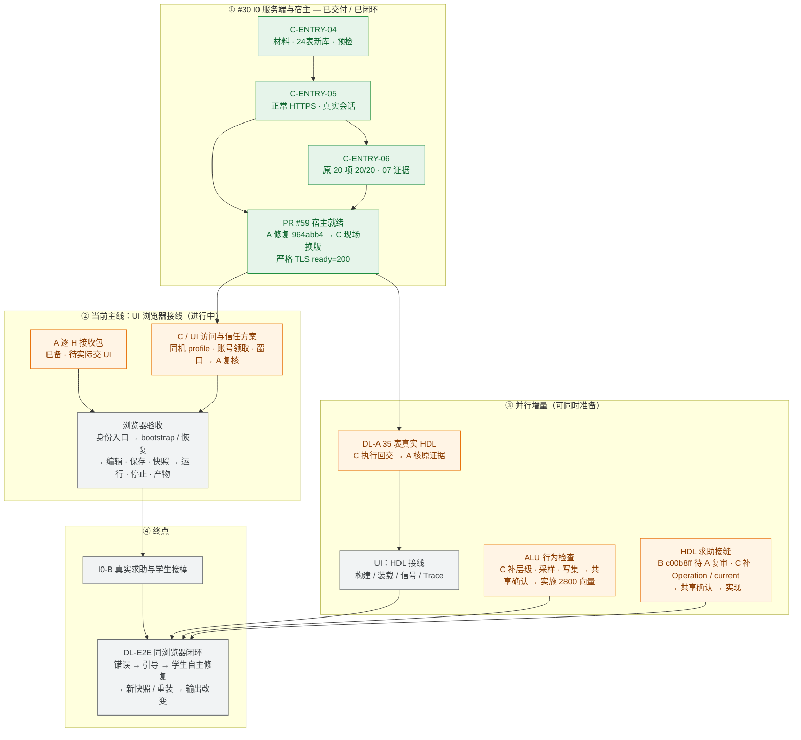

# Issue #30 / #38：待办推进顺序与交接对象

日期：2026-10-14（Asia/Shanghai）。用途：给 A、B、C、UI 及项目负责人分派后续批次，明确前置条件、交付物、接收人和完成判据。

**当前下一步：宿主 `/health/ready` 503 已闭环——A 修复提交 `964abb4` 已推送为 Draft [PR #59](https://github.com/paher-din/XunJie/pull/59)（37/37），C 已在 PAHER 原节点完成现场换版并严格 TLS 实测 `ready=200/data.status=ready/no-store`，原登录/bootstrap/Attempt、24表持久库与 C/HDL 指纹均保持（[现场回交](https://github.com/paher-din/XunJie/pull/59#issuecomment-6162594244)、[记录 §18](https://github.com/paher-din/XunJie/blob/279f2145a33b0526f394f97739a204a1e5f0016c/docs/tasks/DLA_C_CLOSEOUT_HANDOFF.md#18-2026-10-14-批准执行-pr59-的-paher-定向接入)）。后续只按原门禁推进：UI 的浏览器信任/账号通道/登录分配接线与实际浏览器验收；C 补 35 表真实 HDL 增量及 H3/H4 精确读取样例（PR #55 `e492d25`/§14 已交，待 A/B/UI 会审消费，对照[A补充稿](DL_A_H3_H4_REVIEW_20261014.md)）；B 对 #54 的原证据与 PR 结论文本修复已推送 `c00b8ff`（本批已核纯文档增量），只待 A 正式复审结论。隔离完整回归未全通过，实际结果列于§3.3；真实现场与浏览器验收各有剩余条件。**

本文件仅为本地协调清单，步骤编号不是新建远端任务票。它整理现有决定，不新增共享契约、运行参数、数据库或操作授权，不取代原任务和验收条件。

**阅读与分派以§1～7的当前正文为准。** §8仅保留各批历史检查事实，其中旧“下一步/未执行/待修”不作为当前派工。本文后续更新须同步摘要、PR表、顺序图和各步骤的状态/剩余行动，不能只在末尾追加进度。

## 1. 来源、时点与职责

本清单依据2026-10-14本批已完成的远端同步与读取：`git fetch`后main仍为`eea9623`（含UI PR #57、交付记录PR #58），开放PR为#53～#56、#59；本批重读#30（19条评论）、#38（4条评论）及PR #59正文/回交、PR #55正文/评论，并增量复核PR #54新head与PR #53新head。4个旧PR与22张相关issue的读取范围沿§8.1～8.4记录；其余20张issue状态仍是较早读取结果，不冒充重新查询。固定点及实际结果见§1.1、§3.2～3.3。本批未执行业务测试、未启动现场服务，也未做原受控库/秘密日志审计，不等于完整产品验收。

核心交接来源：

- [#30：I0 学生端最小学习闭环](https://github.com/paher-din/XunJie/issues/30)：本批核对19条评论，最后更新2026-10-14 14:46（[C登记PR59现场闭环](https://github.com/paher-din/XunJie/issues/30#issuecomment-6161397303)，该评论已就地更新）。
- [#38：DL-A 数字逻辑业务接入](https://github.com/paher-din/XunJie/issues/38)：本批核对4条评论，最后更新2026-10-14 12:35（[C 补交 H3/H4](https://github.com/paher-din/XunJie/issues/38#issuecomment-6160979614)）。
- [UI 的 H-01～H-06 交接清单](https://github.com/paher-din/XunJie/issues/30#issuecomment-6137496293)、[分支与集成协作方式](https://github.com/paher-din/XunJie/issues/30#issuecomment-6137712134)。
- [A/C 最新分派](https://github.com/paher-din/XunJie/issues/30#issuecomment-6147767208)、[A 实审与逐 H 状态](https://github.com/paher-din/XunJie/issues/30#issuecomment-6150093733)、[精确授权及 C 连续执行安排](https://github.com/paher-din/XunJie/issues/30#issuecomment-6150203466)。
- [C在#30同步最终结果](https://github.com/paher-din/XunJie/issues/30#issuecomment-6152130970)（02:14:20）、[已发布的UI/C剩余任务](https://github.com/paher-din/XunJie/issues/30#issuecomment-6155068633)（04:58:34）。后一评论已发布，本轮不重复发布；其中的宿主readiness项已由PR #59现场闭环取代，不再按原“待修复”执行。
- [DL-A 收尾与去重清单](https://github.com/paher-din/XunJie/issues/38#issuecomment-6145619173)、[C 的 ALU 提案](https://github.com/paher-din/XunJie/issues/38#issuecomment-6147371151)、[B 的 HDL 上下文回交](https://github.com/paher-din/XunJie/issues/38#issuecomment-6148072076)、[C 补交 H3/H4（PR #55 e492d25/§14）](https://github.com/paher-din/XunJie/issues/38#issuecomment-6160979614)。
- [C 在 PR #59 登记宿主readiness现场闭环](https://github.com/paher-din/XunJie/pull/59#issuecomment-6162594244)（14:46），运行源固定`964abb4`；[PR #55 head 279f214](https://github.com/paher-din/XunJie/pull/55) 的正文与4条评论已核。

另已阅读本地 [AGENTS](../../AGENTS.md)、[README](../../README.md)、[PRD](../product/PRD.md) §4～8、[MVP_SPEC](../product/MVP_SPEC.md) M-02～05/M-10、状态/AC/NFR/完成定义、[TECH_DESIGN](../product/TECH_DESIGN.md) §3.3/4.3/6.1/7.3～7.4、[TEAM_WORK_PLAN](../planning/TEAM_WORK_PLAN.md) 职责、最小交接包与最终接入章节。本地基线有较早的状态和未提交修改；本清单的当前事实以以上固定远端回交为准，不覆盖本地基线或修改正式排程。

| 角色 | 人员/账号 | 本轮责任 | 接收交付后继续做什么 |
| --- | --- | --- | --- |
| A | 用户 / czr112 | 身份、权限、活动、业务宿主、共享契约汇总、集成质量和证据复核；修 A 模块问题 | 已核C证据、B离线修复并备好逐H/H3/H4包；交对应接收人，收C/UI精确输入后汇总共享写集→负责人 |
| B | scy404 | 模型、教学上下文、政策/当前性守卫与语义验证；修 B 模块问题 | 接 A/C 的授权读取和当前性接缝，完成求助输入链适配与教学交付 |
| C | paher-din | PAHER 现场准备与获准执行；作品、快照、原 Job、执行、记录/回执；修 C 模块问题 | #30 C-ENTRY-04～07已回交；响应具体证据缺口，与UI交访问/运行方案；再按独立批准范围追加HDL批次 |
| UI | wubq511，沿 Robert 的现有协作安排 | 现有界面真实接线、浏览器访问/信任方案、草稿/版本、真实展示回执和键盘路径 | 接 A 复核过的入口与逐能力交付，验证对应浏览器链，回报缺口给 A 和原模块负责人 |
| 项目负责人 | 按现有负责人安排 | 确认尚未冻结的共享方案、实际操作范围及受保护基线维护人 | 接 A 汇总的具体对象/差异作决定；不重复批准已有范围 |

**当前已完成与未完成：** C固定d86e51e的04～06实际20/20、07材料已交；宿主readiness缺口已由A修复（PR #59，37/37）并经C现场换版严格TLS回读ready=200闭环。A已复核、补正visibility并备好[逐H包](I0_A_UI_REVIEWED_HANDOFF_20261014.md)、[H3/H4补充](DL_A_H3_H4_REVIEW_20261014.md)和[独立验证记录](A_CURRENT_NEXT_STEPS_20261014.md)，组合结果见§3.3；逐H包等材料仍待实际交UI。C已补交H3/H4精确材料（e492d25/§14），待A/B/UI会审。35表物理HDL、ALU行为、真实HDL求助和浏览器仍未执行。已发布的#30任务不重复发布，C同一20项不重做。

C的旧UI交接JSON在2026-10-14 01:54:05记录正常停止，已是历史。随后[C在#30回交](https://github.com/paher-din/XunJie/issues/30#issuecomment-6161397303)记录恢复运行、新24表保留库、20/20与178严格TLS响应；其中宿主 `/health/ready` 的503由A修复为PR #59`964abb4`，C已在原节点换版并实测ready200（[现场回交](https://github.com/paher-din/XunJie/pull/59#issuecomment-6162594244)）。本轮同步只读公开回交，没有现场探测，不能把C记录当作持续在线或A独立复跑。当前Assignment=`a2533386-4923-4dee-83bd-2d7a99fb06e9`、Activity=`f0942cb7-75ef-4625-aa92-d649268d61cb`、Attempt=`c9166463-5f46-4dc6-82c3-96456f394258`，与PR59现场回读一致；旧ID仅作历史。C/UI下一步只在UI窗口核浏览器条件与当前readiness；不重建同批库/账号。

该 I0 授权没有包含浏览器/系统信任、35表 HDL、ALU、模型调用或生产部署。不能将“未包含在此次授权中”改写为“以前所有相关授权均不存在”：开展后续批次时先核其独立已有批准范围，只补真正未覆盖的对象。已批准的24表、35表临时合成初始化范围不重复申请。

### 1.1 五个开放PR的固定检查结果与当前待办

本地main仍为`eea962322ace4a1fd3dc86ce531adf5711552da9`（含UI PR #57及交付记录PR #58），本批`git fetch`无新main提交。下表head已按本批远端`refs/pull/*/head`逐条回读（#53/#54/#55/#56/#59）；Open/Draft为当前状态，机械可合并不是业务验收。后续head/main变化只复核增量。

| PR / 主责 | 固定head / 状态 | 当前已有交付 | 下一项与接收人 |
| --- | --- | --- | --- |
| [#53 I0-A / A](https://github.com/paher-din/XunJie/pull/53) | `869f3c0fc53884e573761ba43cec72000fc91f98`（fe6d301后新增4个A交接文档提交）；Open/Draft | 原HTTPS/bootstrap/消费者及固定专项已核；visibility样例、逐H接收包与交付文档已随本head推送 | C已在PR #59源上完成宿主换版与ready200；UI按当前运行源接线。逐H包交UI，原审核/visibility不重复派发 |
| [#54 DL-B / B](https://github.com/paher-din/XunJie/pull/54) | `c00b8ff87114e1522b02a8a0c288b0184799b099`（b698480后新增1个纯文档提交）；Open，非Draft；旧8ff68cd的CHANGES_REQUESTED仍保留 | A独立类型/构建通过（代码固定b698480）；本批已核`c00b8ff`增量diff：恢复原模型句子、新增§16勘误，PR正文已改为“有条件通过” | A正式增量复审结论→原PR审查串；如需更新GitHub review状态由A执行。不改代码、不重跑已消费模型批次 |
| [#55 C-ENTRY / C](https://github.com/paher-din/XunJie/pull/55) | `279f2145a33b0526f394f97739a204a1e5f0016c`；Open/Draft；相对main为`dirty`，合入时需按最新main处理 | C已交付：原20/20与178响应、新库恢复、H3/H4补交（§14）、PR #59现场换版（§18，ready200/严格TLS/原对象/指纹保持） | UI按当前运行源接线浏览器；A/B/UI会审H3/H4补交；合入顺序由负责人拍板。旧ID和停止记录仅历史，不重做旧20项/计数 |
| [#56 DL-A / A](https://github.com/paher-din/XunJie/pull/56) | `87a3b795b0e457445edbcd40ecf985e3a0dac012`；Open/Draft，GitHub可合并 | 35表公开固定源及旧记录；C已在PR #55 §14登记接收773文件与指纹核对；新main/B隔离验证、README解冲突稿与H3/H4补充已本地完成 | A交已备材料；实际合入时应用README稿并复核增量。C补真实HDL/精确读取/ALU设计，UI交操作表。隔离准备不等于已合入或现场通过 |
| [#59 I0-A健康修复 / A](https://github.com/paher-din/XunJie/pull/59) | `964abb4277c2cf58e81d6686f6349b6ef0fa2e39`；Open/Draft | `/health/ready`按DB事务/原消费者/节点指纹/恢复代际返回200，缺依赖仍安全503；Node24.21.0 typecheck/build与37/37通过；C已在PAHER原节点换版并严格TLS回读ready200、原对象保持 | A/C该项已闭环，无未完成修复项；合入与部署按负责人指令。UI按当前源接线；浏览器验收仍属H-01/I-5 |

#53/#55/#56/#59本次均没有GitHub正式review；材料内既有审查记录不能写成GitHub批准。GitHub“可合并/可合并状态”仅指机械合并，不是业务验收；#55相对main为dirty，需在合入时按最新main处理。#55/#56正文/旧段落中的“等待精确凭据批准”已被#30最新许可取代，但仅覆盖I0 24表和严格Node客户端。

PR #55的P3计数澄清及A复核均已完成：17是三份接收/准备JSON子集；原14JSON全量27个logs条目、19个不同输出摘要，新HTTPS日志独立记账。不再要求C重交或A重核同一澄清，不累计为测试通过数量。

### 1.2 相关 issue 的已核状态及当前承接关系

| Issue / 状态 | 本推进单如何处理 |
| --- | --- |
| [#30 I0](https://github.com/paher-din/XunJie/issues/30)、[#38 DL-A](https://github.com/paher-din/XunJie/issues/38)：Open | 两条主链；上次核对16/3条评论，更新时间见§1。用§4/§5逐批交接，不以材料或PR合入关闭 |
| [#39 DL-C](https://github.com/paher-din/XunJie/issues/39)、[#40 DL-B](https://github.com/paher-din/XunJie/issues/40)：Open | C补ALU/H4缺项及真实HDL；B修#54原证据与结论残留。已合入DL-C基础和已通过离线修复不重做 |
| [#9 G1](https://github.com/paher-din/XunJie/issues/9)、[#10 A1](https://github.com/paher-din/XunJie/issues/10)、[#12 C1](https://github.com/paher-din/XunJie/issues/12)、[#13 A2](https://github.com/paher-din/XunJie/issues/13)、[#14 C2](https://github.com/paher-din/XunJie/issues/14)、[#25 A3](https://github.com/paher-din/XunJie/issues/25)：Closed | 原服务端权限/活动/工作区/执行/教师提案及G1工程阶段已交；正常宿主组合复用，不重建。C1原证据仍需核当前指纹/代际；完整产品条件由#22/#23等承接 |
| [#11 B1](https://github.com/paher-din/XunJie/issues/11)、[#26 B2](https://github.com/paher-din/XunJie/issues/26)、[#27 C3](https://github.com/paher-din/XunJie/issues/27)、[#24 G2](https://github.com/paher-din/XunJie/issues/24)：Closed | 原工程批次已收口；旧正文勾选/等待描述是历史，不能重新要求整项重做。完整产品条件仍保留 |
| [#45 B/P2-F](https://github.com/paher-din/XunJie/issues/45)：Closed | PR #46已合入，旧真实模型/人工语义批次已有记录；其一次性调用许可已消费，复用证据，不能据此新调用。I0-B浏览器与新组合仍待验 |
| [#41 A4](https://github.com/paher-din/XunJie/issues/41)、[#42 B3](https://github.com/paher-din/XunJie/issues/42)、[#43 C4](https://github.com/paher-din/XunJie/issues/43)：Open | PR #49/#52/#47已合入；A4/C4能力与B3核心可复用。C对A4正式复核、B对B2/A4接缝复核已有交付，A本批固定源码/隔离组合回归已完成。余下裁决/真实输入/恢复/闭环分别见§3.3，不重派同批核对 |
| [#44 A5](https://github.com/paher-din/XunJie/issues/44)、[#37 P3协调](https://github.com/paher-din/XunJie/issues/37)：Open | A5可以按已有A4/C4批次开展；不把整项A5/B3结束设成I0-A或HDL基础链前置。两条P3出口分别验收 |
| [#22 完整UI/AC/NFR](https://github.com/paher-din/XunJie/issues/22)：Open | UI #50/#51已合入，最新108/108浏览器结果仅覆盖合成准备工程；真实后台/TLS/节点/回执、键盘、负载/恢复/真人仍待验 |
| [#23 环境稳定性](https://github.com/paher-din/XunJie/issues/23)：Open | 新Linux475项仍有启动超时，原生目录startup 4/4只支持挂载盘归因，不是原生全量通过。A6/C5承接稳定环境完整复验；旧419项及本批专项不能关闭此门禁 |

当前状态按后续固定交付/裁决更新，不按旧正文“等待全部P2”阻塞已明确获准的独立批次；也不把行政关闭写成完整G2/P3/MVP通过。

## 2. 两张任务各管什么，哪些只做一次

| 能力 | 主跟踪位置 | #38 如何复用或追加 |
| --- | --- | --- |
| HTTPS、Session/CSRF、合成账号、访问方式、账号安全领取 | #30 H-01 / I0-ENTRY | DLA-H2 引用同一基础交付；核 DL-A 自身活动/政策配置 |
| 合法 Assignment、首次受信代际、恢复读取 | #30 H-02/H-03 | 复用授权和 bootstrap 能力，另核 HDL 分配与版本绑定 |
| 原 SSH、C/HDL profile/指纹/validation/代际材料 | #30 H-03/H-04 | 复用原材料，执行前核当前性；不重做已完成的节点验收 |
| 正常宿主、静态服务、原 Job 自动消费者 | #30 H-01/H-04 | 复用框架，另验 HDL Build/Session/Operation 和停止组合 |
| 编辑、sync ACK、快照、冲突、恢复、一般错误 | #30 H-05/H-06 | 复用通用能力，另验 .sv/.v、HDL 版本与生命周期 |
| C/TextScope 真实作品链及代码/运行求助 | #30 I0-A / I0-B | 其结果不能代替 HDL 执行、ALU 检查或 HDL 求助 |
| HDL 活动/板卡配置、Build/Session/Trace、提交与停止组合 | #38 DLA-H1 | HDL 增量；由 A/C 验真实组合 |
| ALU 可信行为检查 | #38 DLA-H3 | 独立增量；当前只有提案和数学自检 |
| HDL 求助可信上下文与当前性 | #38 DLA-H4 | B离线代码修复已核，原证据/PR结论仍需改；A补充已准备，C精确Operation/current读取及真实授权/投递待接 |
| HDL 操作表、真实板信号与同浏览器 DL-E2E | #38 DLA-H5 | UI 的 HDL 增量；保留实际极性、X/Z、模拟时间和覆盖缺口 |

注意：#30 的 H-01 不等于 #38 的 DLA-H1，两组编号不能按数字对应。I0 用24表库，DL-A 用35表库；两者分别新建、保留、验证，不混库、不迁移旧库，不互填验收结果。

## 3. 总推进顺序与可并行工作



**图例：** 绿色 = 已交付 / 已闭环；橙色 = 进行中（材料已交、待会审或待现场执行）；灰色 = 待启动。图中箭头表示对应能力的前置条件，不要求整张 issue 先关闭。宿主 readiness 闭环（R59）已把当前运行源更新为 PR #59；A 的逐 H 接收包仍待实际交 UI，UI 实际接收 / 访问与浏览器验收另计。③ 的三条增量可与 ② 并行准备。现场实现 / 模型 / 浏览器操作按各自准确授权，本图不新增许可。

### 3.1 当前剩余行动与接收人

1. **给 C：** 04～07结果、H3/H4补交（PR #55 §14/e492d25）及PR #59现场换版（§18/ready200）均已交；与UI核运行窗口/受控领取/浏览器条件，再准备DL-A固定源及35表真实HDL增量。先核字节和原runner指纹，不重复生成凭据、建同一I0库或重跑同一20项。
2. **给 UI：** 当前应用已由C按PR #59源运行（`https://127.0.0.1:3443`）；与C明确PAHER同机浏览器/用户profile、访问和精确信任操作、账号安全领取方式，交A复核；同时交HDL“现有操作→请求→结果/状态→缺项”表。实际信任操作按覆盖它的许可执行。
3. **给 B/C：** B对§3.2两处残留的文本修复已推送`c00b8ff`（本批A已核增量diff），只待A正式复审结论，代码/main不重做。C已补H4读取契约与H3层级/采样/写集/预算（e492d25），A/B/UI按[补充稿](DL_A_H3_H4_REVIEW_20261014.md)会审；真实Build/Session/Operation/current样例仍缺，待A汇总确认后实施。
4. **A 当前余项：** ①对#54新head`c00b8ff`出增量复审结论并按需更新原PR审查串；②将已备[逐H包](I0_A_UI_REVIEWED_HANDOFF_20261014.md)实际交UI、[H3/H4补充稿](DL_A_H3_H4_REVIEW_20261014.md)交C/B/UI；③汇总C/UI精确输入为共享写集→负责人。宿主健康503不再列为A待办；旧README解冲突稿只针对原固定组合，最新main已同步，不把旧稿覆盖新版。原证据/visibility/独立测试/稿件整理不重做。

### 3.2 B新head复审：b698480代码已核，c00b8ff文本修复已交待正式结论

旧[审查](https://github.com/paher-din/XunJie/pull/54#pullrequestreview-5506952727)固定8ff68cd，作为历史保留。A独立复核b698480：Node24.21.0类型/构建通过，专项35总/33通过/2跳过，tutoring160总/153通过/7跳过；未调用真实模型，不能据代码测试改写原语义裁定。B随后推送`c00b8ff`（纯文档，+12/−1），本批已读其完整diff：恢复原模型完整正文并新增§16勘误，PR正文改为“有条件通过”；该增量仍待A正式复审结论。

| 项目 / 状态 | A已核内容或B下一补正 | 交给谁 / 出口 |
| --- | --- | --- |
| R54-R02代码已核 | 去除C单行message内`/snapshot/…:行号:`前缀，保留诊断文字；按确认源码校验结构化位置；实际SyntheticProvider输入反例通过 | 复用实际离线结果，不要求C改诊断构造器或再改fixture |
| R54-R04代码已核 | `...0010`按bit1=1、bit0=0核验；resetN全部1不能证明复位转换，离线回归通过 | 复用证据限制，不新增模型请求 |
| main/B3合入已核 | 新head包含main及B3；类型/构建、tutoring回归通过 | 不再派旧三处机械冲突；联合树当前结果见§3.3 |
| **B已修1：原证据恢复（P2）** | `c00b8ff`已在human review“模型完整可见正文/unresolved”恢复原始“最低位由0变为1的单帧变化”句子，正确位值/reset边界的勘误移至独立段落，原输出与人工判断分层保存 | 本批已核diff；A正式复审结论→原PR审查串。原始输出、输入摘要修正、人工勘误分别保存 |
| **B已修2：PR正文（P2）** | #54正文已改为HR-DL-02“有条件通过”，保留原模型正文与历史人工判断，未再宣称整批无条件通过；代码/测试数字仍对应b698480 | 本批已核PR正文；A正式复审结论→原PR审查串，不重跑已消费模型 |

两轴报告见[A记录](A_CURRENT_NEXT_STEPS_20261014.md)及[当前PR审查报告](PR54_REVIEW_20261014.md)：Standards硬违反2/异味0，Spec问题1（同一原证据改写问题分别出现于两轴，不合并统计），均已由`c00b8ff`文本修复覆盖、待复审。此前结论已[附加到PR #54](https://github.com/paher-din/XunJie/pull/54#issuecomment-6161601734)；GitHub旧CHANGES_REQUESTED仍存在，新head未取得新的GitHub批准。R54-R01白名单已核闭；A/C读取方案可并行会审，真实接线与语义出口仍需对应共享确认及实际验证。

### 3.3 A 的集成去重与另线遗留

- **在途PR组合：** A已隔离核#53/main、#56/main、#56/B新head（B含main）的组合，固定树及实际结果见§8.4。#55是C证据文档且已含PR #59现场接入；#54代码已核、两处文本残留已由`c00b8ff`修复待正式复审；#59为A的健康修复、已被C现场接收。准备顺序不授权本轮合并，固定源现场接收不必等全部PR合入。
- **本轮文件级去重已核：** #53/#56变更清单交集9文件，完整Git tree均未截断。4个相同blob为 `contracts/design/i0.ts`、`server/app/i0-initialize.ts`、`server/app/i0-static.ts`、`server/app/i0.test.ts`（均位于 `apps/teaching/`），保留一份即可；其余 `README.md`、`server/app.ts`、`server/app/config.ts`、`server/app/i0.ts`、`server/main.ts` 内容不同，不能整文件择一覆盖。两head比较为diverged，不能用#56直接替代#53或latest main。
- **关键差异与实际验证：** #56复用original-job-host，I0守24表，HDL配置守35表，模式互斥。三个隔离树类型/构建均通过；I0/main宿主10/10、DL-A/main三文件30/30，通过实际loopback HTTP/Session、原worker与真实合成事务验证，完整联合树结果见§8.4。没有远端合入或物理C/HDL/浏览器复跑；#55原20项不迁移为这些新组合结果。
- **#53/#56实际合入前仍需处理：** 直接merge-tree仅README有冲突；该树应用源码与#56逐项相同。A已准备[解冲突稿](evidence/a-next-20261014/readme-resolution.txt)，同时保留I0§17与DL-A入口/模式/范围/验证边界。诊断树`f9f0721914eb197ec1db6a7f83d66066dfd023bb`未合入原分支或提交，实际合入时复核head增量，不整文件择一覆盖。

**当前验证结果（各批分开，不累计）：** 固定树/命令/原日志见[收据](evidence/a-next-20261014/verification.json)，无需读到历史附录才能判断是否已经验证。

| 已执行范围 | 实际结果 | 当前结论与剩余限制 |
| --- | --- | --- |
| #53/main、#56/main、#56/B三个隔离树 | 类型检查/构建全部通过；前两宿主专项10/10、30/30 | 独立集成准备已做，不再列为待验；不是实际合入或现场通过 |
| #56/B最终宿主三文件专项 | 30/30通过；31个新库存在（24表10个、35表21个），只读清点错误0 | 已明确保留关键专项合成库；原整套默认临时库保留未核实，不能相互代替 |
| Windows完整回归 | 464总/443通过/2失败/19跳过 | 未全通过；缺dist失败已补原等字节构建后I0专项10/10，另一个需要Linux可信控制环境 |
| Linux挂载盘完整回归 | 475总/458通过/1失败/1超时取消/15跳过 | 未全通过；原5秒/10秒启动限时超时，旧失败记录保留，稳定全量另挂#23 |
| 同源码/运行时的WSL原生启动专项 | 4/4通过，原两个子进程约202ms/298ms | 支持挂载盘读取归因；原生全量未复跑，不能写475项已通过 |
| 同版Icarus时基专项 | 5/5通过 | 只解压原批准版本，未维护节点；不倒写全量跳过或累计为ALU/物理HDL通过 |
| PR #59健康修复 | Node24.21.0原lock typecheck/build通过；专项与原回归37/37，0失败/跳过；26个合成库保留、integrity_check全ok | 本地回归通过；C已在原节点换版并严格TLS回读ready200（[现场回交](https://github.com/paher-din/XunJie/pull/59#issuecomment-6162594244)）；浏览器/H-01仍未执行 |

当前未执行：35表物理HDL正常业务组合、ALU行为、真实HDL-help接线/模型及浏览器/系统信任。A的逐H材料仍未实际交UI；C的H3/H4补交待会审；PR #54新head待A正式复审结论。原失败、跳过、临时库保留缺口与专项通过均独立记录；PR #59的C现场回读为他人执行证据，不并入本文本地37/37。

- **A4跨域收口：** [C正式合并后复核](https://github.com/paher-din/XunJie/issues/43#issuecomment-6138247005)已在94ad99c执行，C3四套件29/29，停止原因修复已闭；不用再催C完成同一复核。轮询失效事件actor/时间仍待负责人裁决；取消后的 `invalidatedActionIds=[]` 不表示无影响，A向B/UI转达消费限制。B2/A4可选读取复核已随[PR #52](https://github.com/paher-din/XunJie/pull/52)交付；既有复核记录已收到，A本批固定源码/隔离组合回归已完成，各自覆盖范围分列，不因issue旧评论Pending重派。新组合改变相关代码时再验增量。
- **B3实际输入链：** [PR #52裁决](https://github.com/paher-din/XunJie/pull/52#pullrequestreview-5505569771)已确认调用计数语义并合入77870b2；合入当时由审查者实施、未独立复核，本批已对包含它的B新head与联合树执行独立服务端回归。真实learner_analysis worker的持久预留/安全释放/未知对账，以及C2/C3/C4实际输入→A4接纳仍需B/C交证据，A核授权/装配；不重复派“重新裁决调用计数”。新模型调用单独核准确许可，不沿用已消费的旧许可。
- **A5与完整产品：** A按#44接正式反馈/最新提交修订许可，C接学生主动重开/完整恢复，B草稿可选。此链挂#37/#41～44，不要求UI再次交H-01～H-06；#23稳定性和#22完整AC/NFR按原责任另验，不拿模块测试或合成Chrome108项替代。

## 4. #30 的顺序、交付物与接收人

### I-1：现场材料、24表新库与预检——C已交，A复核已完成

- **已完成：** C-ENTRY-04已交，A已核[preparation.json](https://github.com/paher-din/XunJie/blob/d86e51e8b09f283e9249d0e85e70cc4df873aff9/docs/tasks/evidence/c-entry-https/preparation.json)：24表、五账号、两课程、独立政策ID、原源/指纹/代际对应。未读取现场库或认证文件。
- **固定来源：** PAHER/WSL、Node24.21.0、原lock；运行源`9fa76adbfb37a60cc087f8bf2fbdd1e05cd18e77`；非秘密配置/实际新库引用及原预检已纳入#55，不再索取同一包。
- **当前剩余：** 无同批初始化/材料准备待办。C/UI在实际接线窗口开始前只核现有文件可用、当前readiness/指纹/代际和配置；来源有变化再交增量。
- **下一责任：** C/UI→A，交窗口/实际访问/安全领取方案，转I-2与I-5；不重新生成同一凭据或创建同一I0库。若现场现状不符，保留事实和准确缺项，不覆盖、删除或绕过。

### I-2：HTTPS与真实会话——C验收已交，A接收包已备，待UI实际访问

- **已完成：** C-ENTRY-05原main/real dist/250ms原消费者的严格Node HTTPS、页面/资产、匿名401、五账号Session与成员、Origin/CSRF拒绝已测；A脚本/响应/TLS公开证据复核及[逐H包](I0_A_UI_REVIEWED_HANDOFF_20261014.md)整理已完成。
- **当前剩余：** 宿主readiness已闭环（PR #59，C现场ready200）；UI尚未实际访问。C/UI交PAHER同机浏览器/profile、精确信任对象/操作范围、账号安全领取及窗口→A复核，不沿用旧停止记录推断当前状态；当前服务是否持续在线以C的PR #59记录为准，本文不现场探测。
- **A下一行动：** 将已备入口包交UI；收到具体方案后核差异/原许可覆盖，缺覆盖只列新增对象。无需重新复核相同Session/TLS日志。
- **出口：** UI实际收到可消费入口、能在明确窗口正常访问；浏览器通过仍由I-5实际记录，Node TLS结果不替代浏览器信任。

### I-3：分配与原20项真实作品链——C已交20/20，A公开证据复核完成

- **已完成：** C-ENTRY-06完整轮[结果](https://github.com/paher-din/XunJie/blob/d86e51e8b09f283e9249d0e85e70cc4df873aff9/docs/tasks/evidence/c-entry-https/verification-final.json)20/20、174严格TLS响应；正常教师检查/确认/分配→学生bootstrap/保存/head/快照→原消费者真实C1，含授权拒绝、旧revision、重放/冲突、取消/暂停/裁剪。A已核公开证据，不记为A独立复跑。
- **失败记录保留：** 首轮11通过/1验证失败（13～20未执行），第二轮8通过/1输入失败及UI交接启动等待失败；不将三轮相加。
- **已交对象：** 合法Assignment/Activity/Attempt引用、未分配/暂停响应、原Snapshot/Job/Run/回执、版本/代际与日志已在#55。前端路由尚未接，不把对象ID称为已可用的学生深链。
- **当前剩余：** 同一20项没有执行/回交待办；UI沿I-4/I-5消费已有材料并验真实界面。真实断线/未知终止故障注入未执行，不能以合成transport或短暂unknown代替；新增故障批次须核准确范围。

### I-4：A逐H复核/补正/包已完成——剩余实际交UI及接收确认

- **当前结论：** 公开证据复核、原手册visibility本地补正和[逐H包](I0_A_UI_REVIEWED_HANDOFF_20261014.md)已准备；受控原库/秘密日志、现场当前在线与浏览器未验证。H-01的宿主readiness项已由PR #59闭环；逐H包尚未实际交UI，I-4接收/实际消费未完成。
- **已满足前置：** I-2/I-3完整公开批次已收到并核完，无需继续等待同批C证据。
- **已完成工作：** H-01～H-06原输出/权限/版本/代际/原ID/消费方式核对、visibility本地补正、07入口/日志计数澄清与逐H整理。保护默认false/false未改。
- **当前剩余：** A交已备包/原手册补正→UI，UI确认逐H收到的材料与缺口；UI提交现有路由/请求映射→A核差异。只有固定源/现场输入变化或新问题才复核增量。身份/活动/宿主问题回A，workspace/records/runner回C，前端回UI，教学上下文回B。
- **交给：** A → UI；模块缺陷 → 原模块负责人；受保护基线差异 → 项目负责人指定的维护者。
- **交付物：** 每个H的“已交材料/联调通过/失败/未执行”、固定代码/契约入口、UI需要的样例与已知限制、待执行项及责任人。
- **出口：** UI清楚哪些能力可接、哪些仍缺；不把C代跑结果写为A独立复测，不将材料接收勾成整卡验收。

旧固定批已核：unknown不是终态，脚本仅轮询原身份；旧Job取消确认后才明确新合成Run。第二轮公开资源403符合安全默认，C经原教师接口显式分享并固定新活动后再完整验证。可信检查Job成功而判定预期failed，不等于课程作品通过。分配revision=3/active=true与此前暂停revision=2/active=false属于前后状态。旧九个student_run的6 succeeded/3 cancelled、旧对象ID和停止事实仅用于原批追溯；新恢复批见§1，不替换旧证据。A未现场查库。实际transport断线注入、模型、HDL及浏览器仍未执行。旧入口/原证据见[C执行记录§13](https://github.com/paher-din/XunJie/blob/d86e51e8b09f283e9249d0e85e70cc4df873aff9/docs/tasks/DLA_C_CLOSEOUT_HANDOFF.md#13-2026-10-14-a-实审接收计数澄清与-c-连续执行)及[UI交接](https://github.com/paher-din/XunJie/blob/d86e51e8b09f283e9249d0e85e70cc4df873aff9/docs/tasks/evidence/c-entry-https/ui-handoff.json)。当前接线引用§1新恢复对象；main已合入PR #57真实入口能力，UI实际页面/浏览器完成状态仍须本人回交，不再把旧“前端路由未接”当当前代码事实。

| H / 已完成的A复核与整理 | 固定证据与实际覆盖 | 当前剩余项 / 下一责任人 |
| --- | --- | --- |
| H-01：入口/身份 | 原严格TLS批174响应中158份正文hash匹配、16份按清单裁剪；五身份/Origin/CSRF公开证据已核。新恢复批178响应仅据C回交；PR #59固定964abb4已在原节点换版，严格TLS ready200并保持原Assignment/bootstrap/Attempt | A修复项已闭环；UI/C交同机profile、URL/窗口、信任与受控领取方案→A。UI仍待实际浏览器访问 |
| H-02：合法分配 | 原教师检查→确认→分配与bootstrap已核；旧`9906a7af`/`ef2137d8`/`e284d4ab`仅历史，当前接线用§1新恢复对象 | A交接口样例→UI，UI回交本人入口/空态实际结果。C新评论明确公开visibility补正已完成，不再派发；新对象事实与完整权限验收分开，不写全AC-02通过 |
| H-03：版本/恢复 | 初始sync后attemptRevision=2/workspaceRevision=1/decisionEpoch=0；原代际及head对应；旧代际写入409 RECOVERY_REQUIRED、只读恢复200且未增Job/替换Attempt | UI核首次bootstrap与刷新/恢复实际消费；现场备份/重启恢复未执行，该GET恢复样例不计完整NFR恢复验收 |
| H-04：原执行/停止 | 原Job `cba4053d`/Run `867304ef`自动消费与取消已核，旧服务退出0是历史；新恢复批原消费者3 succeeded/1 cancelled据C回交，不能和旧批累计；PR #59换版后四Job终态3 succeeded/1 cancelled/未结0保持一致 | A宿主健康修复已闭环（C现场ready200）；C/UI核当前节点/代际，UI实际运行/取消展示。未注入真实断线/未知终止，短暂unknown→成功不计故障恢复已验 |
| H-05：作品/ACK/快照 | 原键重放200/同回执，异正文与旧revision均409；旧快照输出保持旧正文；暂停仍允许更新/快照，拒绝创建/回收/恢复文件及Run | UI实际接编辑/ACK/head/快照、草稿隔离、多标签冲突、刷新/断网/重连、键盘路径；服务端样例不替代浏览器验收 |
| H-06：结果/拒绝与限制 | 原可信检查Job成功但verdict=failed，私有产物redacted；报告正文/bytes/hash与原Run/Snapshot对应，授权/路径反例已核 | 原公开/私有visibility补正按C负责人新确认已完成；UI接报告/裁剪/拒绝，C保留原证据。无模型、HDL/ALU、真人或完整AC/NFR通过结论 |

只读完整性入口：[公开manifest](https://github.com/paher-din/XunJie/blob/d86e51e8b09f283e9249d0e85e70cc4df873aff9/docs/tasks/evidence/c-entry-https/manifest.json)、[完整HTTP投影](https://github.com/paher-din/XunJie/blob/d86e51e8b09f283e9249d0e85e70cc4df873aff9/docs/tasks/evidence/c-entry-https/http-final.json)。A重算9个公开文件及5段内嵌日志的bytes/SHA-256全部匹配；这证明公开材料内部一致，不证明受控原日志未裁剪或现场库当前状态。用例统计仍只记C完整轮20/20，不新增一批业务“通过数”。

### I-5：UI实际浏览器接线——待访问方案、入口接收与逐H实测

- **前置：** 对应能力经A复核可接，实际浏览器访问/信任操作获得覆盖它的许可。
- **执行顺序：** 身份/合法入口/空态 → bootstrap与恢复 → 编辑/确认保存/head/快照 → 原运行/停止/历史产物。验证刷新/断网/重连、多标签冲突、账号切换草稿隔离、暂停、旧代际/旧快照/重复请求等原I0-A条件；补实际键盘路径。
- **交给：** UI → A；故障同时附给原模块负责人。
- **交付物：** UI固定SHA/PR、浏览器/环境、逐H实际结果与证据、接口差异和未覆盖项。不回退prep fixture，不把未知显示已停止，缺产物/正文不补造。
- **出口：** 对应浏览器能力已验，严重越权/丢失/隔离缺失/无法保存已处理；剩余完整AC/NFR交#22，不把少量增量样本记为整项NFR达标。

### I-6：I0-B正常宿主/浏览器辅导与学生接棒——实际闭环待验

- **前置：** 对应I0-A作品、版本与运行引用可实际使用；复用已收口B1/B2/C3和#45模型/语义记录，核正常宿主实际装配及本次新增调用范围。历史许可已消费，不从旧正文推断核心或模型批次尚未交付，也不以旧许可开启新请求。
- **执行：** B核真实provider、政策/最小上下文/引用与当前性；A接真实授权和活动；C接原Job/Message/TeachingAction/Delivery/Receipt/取消；UI实际渲染和回执。代码、运行两类求助分别走内容→停止/返回→学生自主修订→新快照运行，并核迟到/替换/重连及限定帮助。
- **交给：** B/C → A和UI；UI真实链证据、实际教学审阅者语义结论 → A。
- **交付物：** 已完成模型/人工审阅的固定证据链接，及本次正常宿主调用链、真实显示/停止/回执/学生接棒的新增证据；说明新组合与旧批次差异，不要求重跑旧批次来取得相同记录。
- **出口：** 原I0-B条件有逐项证据。真实模型、人工语义、浏览器、真人和教学效果分别记录；调用/总时限/预算沿原条件。确需新增模型请求而无覆盖它的许可时，列精确输入/模型/请求上限/成本和接收方给负责人；其余无调用的接线准备继续。

## 5. #38 的顺序、交付物与接收人

### D-1：A固定源/集成准备已完成——C接收与UI操作表待回交

- **A交C：** [Draft PR #56](https://github.com/paher-din/XunJie/pull/56)、固定已测运行源 `89c85ed04db5a55ddebdc95c27303f0ff76fa31c`、手册§18/19及773文件原字节/mode清单，已公开，不再等待A发布。
- **C交A：** 固定源接收已交（PR #55 §14登记773文件接收与指纹核对）；执行位置/窗口、正常HDL批次的实际配置引用和现有授权覆盖/缺项仍待C/UI补齐。
- **UI交A/C/B：** DLA-H5操作对应表和固定提交，列保存、Build/诊断、装载/替换、SW/按钮/reset/推进、LED/段选/位选/Trace、unknown/停止/恢复的真实接口与缺口。
- **A出口：** §3.3/§8.4已明确latest main/B3的隔离树与实际结果、共用宿主去重及README合入冲突；仍不迁移89c85ed旧统计。本批结果/提案本地可审，远端发布/合并按具体指令执行。

### D-2：35表真实HDL组合——待C执行回交，A再核原证据

- **前置：** 共用正常入口条件具备、D-1固定版本与现场范围明确、当前HDL readiness/指纹/代际一致。先核独立已有批准范围；#30的I0许可不能自动扩到此批，未覆盖的现场对象另列给负责人。
- **C执行：** 按独立获准范围新建保留35表合成库；正常登录、HDL活动检查→确认→分配、学生保存/Build/装载/交互/Trace；原Job消费、C4提交/许可重开、暂停/撤权/停止/未知/重放冲突组合。
- **许可重开边界：** 沿本批现有公共能力或已批准受控事务接缝验证，记录实际通道；不能把合成许可组合写成A5正式反馈HTTP链已交付。完整“正式反馈→允许修订→学生主动继续”仍由A5/C4对应批次完成。
- **交给：** C → A复核 → UI。DLA-H2共用入口引用#30，不重新制作同一证书或索要同一份节点材料。
- **交付物：** HDL原Snapshot/Build/Session/Operation/Job绑定、活动/配置版本、实际Frame/Trace/覆盖、暂停/撤权/提交与终止确认原证据。
- **出口：** 两课程授权、原C回归、HDL生命周期组合通过；未执行项保留。撤权/禁用若通过获准受控事务接缝验证，写明实际通道，不虚构管理HTTP接口或直接SQL补状态。

### D-3：A/C 完成 ALU 会审，获准后实现与目标验证（可与 I-1～I-6 并行准备）

- **当前：** 首批材料已交，本地[A补充稿](DL_A_H3_H4_REVIEW_20261014.md)已完成；源码已查明同Attempt未终止Session唯一索引阻止同时保存独立检查Session，C需列准确占用/写集影响。2800/1296只属原数学自检，ALU行为未实现/未执行。
- **C下一交A：** 层级引用语法与校验、稳定采样、独立检查Session占用约束、command/result形状、准确写集、原限额内覆盖2800向量的方案——C已在PR #55 §14/e492d25补交（层级分段白名单、编译后真实宽度/方向/范围校验、低相位3样本稳定窗、command/result与准确写集、预算774368字节<1MiB、单包8768<64KiB，保留每Attempt一个未终止Session限制），待A/B会审确认；仍需实际2800向量在step/总期限内证明，数学预算不计行为通过。
- **A已准备：** 学生声明/教师确认的不可变绑定、规则/覆盖、授权/持久化/裁剪、重复/停止/迟到矩阵已在[补充稿](DL_A_H3_H4_REVIEW_20261014.md)，不再列为待整理。**A剩余：** 将稿件交C/B/UI，收C准确解析/采样/占用/写集及UI消费差异后完成可实施确认包→负责人。
- **确认后：** A实施本域活动/权限/业务接缝；C实施执行器/比较器和目标反例，各自修复。涉及runner指纹变化时，准确运行/维护范围获批后重验登记，不能沿用旧ready。
- **交给：** C原执行证据 → A；A公开结果与版本/政策说明 → UI/B。私有检查向量/答案不进入学生或B上下文。
- **出口：** 真实正误逻辑、不同合法映射、X/Z、伪造输出、旧引用/代际、重复/停止等有证据；覆盖不足/超时/未知终止不能passed。只等待具体输入/决定，不等待整个#39关闭。

### D-4：A/B/C 完成 HDL 求助接缝，接真实读取与教学投递（可与 D-3 并行）

- **B先交原审查者/A：** §3.2代码/main已由A核；只补原模型正文恢复及PR准确条件结论，交固定增量复审，不重跑已消费模型。旧审查/作者声明按时点保留。
- **C下一交A/B：** 现有Build/Session读取已核，不重写；交精确operationId/同事务current接缝方案及pending/停止/替换/终止实际样例，具体实现先纳入共享确认。[补充稿§3](DL_A_H3_H4_REVIEW_20261014.md)列现有保障与缺项。
- **A下一交B/C/负责人：** [本地最小接线提案](DL_A_H3_H4_REVIEW_20261014.md)已准备，涵盖显式选择/原问题摘要/同事务授权/current/结果哈希/C3投递与回执版本再核；收C/UI精确输入后形成可实施写集，先确认共享字段/状态。
- **修复复审与共享确认后：** A接真实授权/活动/current；C接原读取和记录/投递/取消；B适配已获准真实输入与当前性守卫；UI接展示、过时、停止/返回和实际回执。真实模型批次核新的准确许可；当前离线修复不需要追加模型请求。
- **交给：** 各域固定代码/契约/反例 → A汇总并交UI；真实内容/实际语义审阅与浏览器证据 → A。
- **出口：** 实际源码/诊断/输入/Frame/有限Trace有可信绑定；旧对象/跨归属/私有/迟到/停止不进入当前教学链。工程修复通过和HR-DL-02语义裁定分别记录；新批实际语义未验不能宣布完整DL-AC-08。不等待B3或整个#40收口；首批表已交，不再索取。

### D-5：真实HDL浏览器与最终DL-E2E——对应能力/操作表具备后执行

- **前置：** D-2具备的能力逐批交UI，UI操作表已核；不必等D-3/D-4全部完成才接Build/装载/信号/Trace。
- **UI执行：** 在已合入工程逐批接保存→构建/诊断→装载/替换→输入/显式推进→真实板信号/有限Trace→停止/恢复。保留极性、X/Z、模拟时间/版本；界面脚本模拟不计真实仿真。
- **A组织最终闭环：** 对应执行、ALU检查和HDL求助批次及许可具备后，与UI/B/C在同一实际浏览器验证错误→引导→学生自主修复→新快照/重装→输出改变，同时核原C/认证/活动回归。
- **交给：** UI/B/C逐项证据 → A；A汇总DL-AC覆盖与未完成项 → #38/#37，并向后续A6/完整验收接收方回交。
- **出口：** 对应DL-AC有实际模块/浏览器证据，严重问题已处理。#30、#38、#22的关闭条件分别核，不用服务端或文档通过代替整卡、G1～G4、真人/教学验收。

## 6. 已完成或已备材料与交付状态：不再重新派发

| 已完成或已备内容 | 当前交付状态与剩余动作 |
| --- | --- |
| UI PR #50/#51工程及准备浏览器验证 | 接真实后台并补相应浏览器证据，不重新导入整批UI或重建页面 |
| C既有C1、HDL10/10记录及受控连接/代际/原身份材料 | 原材料已交；执行前核当前性，当前在线状态未探测。源码/环境改变时按批准范围处理新失效 |
| 33份Session/SQLite响应及合成故障样例 | 引用原样例，追加正常HTTPS/真实节点组合；不把故障替身改记真实故障 |
| A的I0固定源/20项手册、C-ENTRY02/03方案、A实审及21项独立验证 | visibility与新C实审已完成，逐H接收包已本地准备，待实际交UI；不另编账号表或重复申请精确I0许可 |
| C新交04～07与PR #59现场接入：20/20严格HTTPS/C1自动消费、失败、合法分配/入口、计数澄清、宿主ready200 | A已核固定d86e51e公开证据并补正原手册，仍待交UI；C已按PR #59`964abb4`换版并保持运行（严格TLS/原对象/指纹已回交）。C/UI协调浏览器窗口与实际方案；不催重做同一批次 |
| DL-A35表代码/旧合成回归/清单及公开草稿PR | 旧交付已公开；新固定组合已隔离验证，当前失败/专项/跳过分列§3.3。README解冲突稿已本地准备，仍待实际合入/现场/浏览器，不迁移旧通过数 |
| C的ALU首批提案、B的HDL首批表、A的H3/H4首稿、C的H3/H4补交（PR #55 e492d25/§14） | A补充稿本地已备且尚未实际回交；C补齐H4读取契约与H3层级/采样/写集/预算，待A/B/UI会审；真实Build/Session/Operation/current样例仍缺。不重复催首批方案 |
| B1/B2/C3原核心、#45已收口的模型/人工语义批次 | 复用固定记录，补I0正常宿主与浏览器实际消费；一次性模型许可已消费，不重跑旧批次或重建原Job/消息/回执 |
| A4/C4/B3已合入模块及C/B跨域接缝复核记录 | 既有复核记录已收到，A本批固定源码/隔离组合回归已完成。原裁决/跨域登记按原任务核剩余项；B3真实输入/worker持久预留释放、A5消费与完整恢复仍独立待做，不重派本批回归 |

B首批表、白名单、诊断/位值/reset代码与main合入均复用；§3.2两处文本残留已由B在`c00b8ff`修复，只待A正式复审结论。旧工程issue关闭也不豁免新的真实组合和浏览器验收。

## 7. 回交格式与完成判断

共用现场基础和I0批次回交 **#30**；HDL/ALU/HDL求助/UI增量回交 **#38或原#39/#40任务，并在#38给固定链接**。不要求多个地方重复贴同一日志。下游确认收到后只追当前缺项；有新增失败则回原模块修复。

PR #54原证据/条件结论补正已由B在`c00b8ff`文本修复，A增量复审结论回原PR审查串，#40/#38引用固定结论；B3真实输入/持久释放挂#42/#43，A4裁决/跨域登记挂#41，A5挂#44，稳定性挂#23，完整UI/AC/NFR挂#22，#37汇总两个P3出口。逐H/H3/H4材料仍在本地，发布须覆盖具体对象的授权；PR #54本次审查已按用户“附加评论”指令公开回交，不再要求重复授权或再次发送同一结论。

```text
原任务 / H编号 / 本文步骤：
主责人与本次执行人：
固定源码、集成组合SHA / PR / 手册：
交付给谁、下游可开始哪一项：
已有授权引用、未覆盖对象（如有）：
受控环境/配置引用、实际启动与停止方法：
原对象ID、版本、代际、指纹、实际使用通道：
实际命令/请求响应及原输出来源、去敏摘要：
已交材料 / 已实现 / 通过 / 失败 / 未执行：
剩余项、阻塞对象、下一责任人：
```

公开只放非秘密引用和去敏证据。密码、私钥、token、cookie、CSRF与真实私有正文不进Git/评论/普通日志；账号领取沿已获准安全通道。真实学生输入、修改、运行、提交由本人发起；隔离合成验收不记为真实学习行为。

本清单的完成判断：顺序、负责人、交付对象、前置条件及共用边界清楚，当前正文与固定证据一致，仓库内相对链接有效。本批已完成远端同步（`git fetch`/PR refs回读）、#30/#38评论重读、PR #59/#55回交读取与PR #54`c00b8ff`增量diff核对；未新增业务测试/建库或更新受保护基线，未发布评论或合并PR。逐H/H3/H4材料仍未实际交UI，C的H3/H4补交待会审；现场/模型/浏览器未执行。

后续更新须同时修改摘要、PR表、顺序图及对应步骤的当前状态，再保留历史批次记录。逐项区分“材料已备”“实际回交并收到”“共享方案已确认”“模块已实现”“现场/浏览器已验证”，不能将本地准备记为下游已接收，也不能只在历史记录末尾追加完成情况。

## 8. 历史记录（仅供追溯；当前任务以§1～7为准）

初版创建本文件；原工作区已有README、product/planning修改全部保留。以下按批次保留当时的状态、检查和安排，文中的“本轮/本次”仅指各自批次，不是当前待办或新的执行指令。

- UTF-8读取、6个仓库相对链接存在性、11个推进步骤编号及代码块闭合检查：通过；无替换字符或行尾空白。11个公开来源引用沿已读issue/comment/PR，未另做全部网页锚点检查。
- 新文件空白检查使用 `git diff --no-index --check -- NUL docs/tasks/I0_DLA_NEXT_STEPS.md`：无空白错误输出；退出1（no-index的新文件差异状态）。逐行行尾空白检查退出0，未将差异状态当作业务验证结果。
- 初版当时的远端复核：#30为14条评论、#38为3条评论，两卡均Open。后续固定来源为16/3条评论，见§1；此处不是当前查询结果。
- 初版批次的业务/现场/模型/浏览器验收：未执行。该批文件仅在本地创建，未提交、推送或更新远端评论，未改产品基线或正式分工；后续A隔离验证见当前§3.3及历史§8.4。

### 8.1 历史：2026-10-14 开放PR及相关issue刷新

本次只修改本推进单。阅读全部开放#53～56的正文/评论/review/行内意见和变更文件清单，核关键固定交接文档；阅读§1.2所列22张issue的正文及全部评论，并核PR #52最终合并裁决。#30/#38评论ID及更新时间未变；最终回读发现#55从ea5a652推进到d86e51e，已补读新正文/评论、14文件增量清单、§13及准备/完整结果/清单/UI交接JSON，并据此重排A/C待办。其他三个head及main保持本次固定点。

当时的修正重点：C正常HTTPS20项结果/计数澄清已交，A改为复核并补visibility示例；#54三项P2与三处main冲突、HR-DL-02有条件通过；#45及旧工程批次已收口且许可已消费；C/B的A4消费复核已有记录；B3调用计数已裁决并合入，C持久释放/实际worker仍待接；#53/#56去重顺序、24/35表现场边界及交接对象。此后A复核、示例补正及B代码/main核对已完成；#54当前只余§3.2所列两项文档补正，不再按本段重派旧问题。

本次文档静态验证通过：UTF-8、6个仓库相对链接存在、47个公开来源引用、11个原推进步骤、22张issue覆盖、代码块闭合、无替换字符/尾随空白，检查脚本退出0。公开引用来自本轮实际读取，未另逐一验证所有网页锚点。`git diff --no-index --check -- NUL docs/tasks/I0_DLA_NEXT_STEPS.md` 无空白错误，退出1为新文件差异状态；仅有仓库LF/CRLF提示。

业务/现场/模型/浏览器验收本次未执行；C的20项为已交他人执行证据，不记为本文独立复测。未提交、推送、评论、合并PR或关闭issue；未改源码、受保护基线、凭据、schema、CI或UI。

### 8.2 历史：2026-10-14 只读证据实审与集成差异核对

该批仅更新本文件，保留上一轮记录的时点与结果。重新读取#30/#38（16/3条评论）和4个开放PR；当时PR #54为`8ff68cd751c9c41423560c13f3135805820ae80b`，不是当前§1.1的`b698480`固定点。C结果已同步#30，UI/C剩余任务评论也已发布，该批未重复评论。§1.2其余20张issue未重新读取。

- **公开证据完整性：通过。** PowerShell `Invoke-WebRequest`只读取得固定d86e51e的manifest和9个公开文件，使用UTF-8字节及SHA-256逐一对比：9/9匹配；5段内嵌服务日志bytes/hash：5/5匹配（含启动等待失败的空日志）。174条完整轮HTTP记录中158份保留rawBody哈希：158/158匹配，16份正文按投影规则省略，不能计为正文已核。受控原始日志、原库和认证文件未读取。
- **范围与语义复核：通过，限公开证据。** 只读核准备/三轮结果/两份UI交接/HTTP投影及验证脚本；核固定运行源、原Assignment/Attempt/Snapshot/Job/Run、ACK/head、重放/冲突、unknown/取消、暂停/恢复、私有裁剪及最终服务退出。C完整20/20与两次失败保持原统计；没有新增业务测试通过数，没有逐项完整AC/NFR或浏览器通过结论。
- **集成差异核对：已完成只读部分。** GitHub完整Git tree及两head compare确认9个重叠文件、4同blob/5不同；读取关键差异和共用original-job-host/execution-transport，结论与待验组合见§3.3。未执行合并、冲突修复、类型检查、构建或联合业务测试；GitHub可合并不代替这些检查。
- **当时安排（已由当前§3～5替代）：** A补原手册公开visibility并按H交UI、验证latest main组合、汇总H3/H4；B修3项P2/离线反例/文档裁定/main冲突并交原审查者；C/UI交访问/信任/领取/窗口方案→A，C另交35表HDL真实组合及H3/H4具体缺项，UI交HDL操作映射和后续同浏览器结果。A准备与隔离验证、B代码/main核对此后已完成，不能按本条重新派发；实际回交及具体缺项见当前正文。

本轮未改源码、配置、schema、凭据、CI、UI或其他文档，未提交/推送/合并/关闭任务、未再次发布评论、未调用模型或启动现场服务、未执行浏览器信任。

本轮文档静态检查通过：严格UTF-8读取、6个仓库相对链接存在、51个公开来源引用、11个原推进步骤、4处代码围栏配对、无替换字符/尾随空白，检查退出0。公开引用来自本轮已读来源或保留的上一轮记录，未另逐一核验网页锚点。`git diff --no-index --check -- NUL docs/tasks/I0_DLA_NEXT_STEPS.md` 无空白错误，退出1为未跟踪文件差异，只有LF/CRLF提示。原README、TEAM_WORK_PLAN、MVP_SPEC、TECH_DESIGN和A_WORK_PLAN的5份哈希均与本轮开始相同；git status保持原有修改/未跟踪项，本文件仍在本地保留。该批最终只读回查#30/#38仍Open、16/3条评论，4个PR的head与该批固定点一致；B后续更新由§3.2另行核验，此处不代表本次重新查询远端。

### 8.3 历史：2026-10-14 A手册公开/私有资源示例本地补正

既有A工作区（`codex/i0-a-c-handoff`，HEAD仍为fe6d301）内 `docs/tasks/I0_A_C_HANDOFF.md` 可用。本批仅改该手册§17.5的一处资源正文段落及本推进单对应状态/验证记录；未新建或切换工作区、未复制产品基线。原手册其他段落保留，A工作区原未跟踪typecheck日志保留且哈希未变。

已读该工作区AGENTS/README、PRD §4.1、MVP M-02/M-10与AC-02/15、TECH §4.3及原资源创建/材料处理/投影正文：`server/design/app.ts` 的materialInput将visibility置于material内；`material.ts` 省略kind时为learning_material，省略visibility仍为false/false；private_answer不可设置student/tutor可见。依据现有契约补示例，不改变共享字段或产品边界。

- **实际补正：** 同一段给出两份可解析JSON请求。公开TXT显式 `material.visibility={student:true,tutor:true}`；教师私有answer显式 `material.kind=private_answer` 及 `material.visibility={student:false,tutor:false}`。两者均保留recoveryGeneration、teacherDesignAllowed、format/title/content；`<G>`仅为当前受控代际占位，不能直接执行。省略visibility的安全默认仍保持false/false，不将teacherDesignAllowed当成学生分享权限。
- **静态验证：通过。** PowerShell解析2份JSON、核外层/嵌套字段、必填类型、公开/私有可见性及kind默认；只读核原后台默认未改。手册严格UTF-8、18个相对链接存在、52处代码围栏配对、无替换字符/行尾空白；`git diff --check -- docs/tasks/I0_A_C_HANDOFF.md`退出0。Git差异仅1行增加/1行删除，原typecheck日志不变。推进单链接/格式另按下述结果核验。
- **该批交付状态：本地补正完成，尚未远端交付。** 未提交、推送或发布评论；公开PR #53固定head手册仍为原稿，不能称UI/C已收到此补正。此前C已显式分享后的20项证据保留，不重跑来证明同一结果；本批HTTP业务、现场、模型及浏览器检查均未执行。当时安排的逐H接收包、latest main隔离验证及H3/H4补充稿此后已完成；实际回交尚待执行，当前行动见§3.1，不再把这些准备工作列为未做。

推进单静态检查通过：UTF-8、6个相对链接、51个公开来源引用、11个原推进步骤、4处代码围栏配对，无替换字符/尾随空白，退出0。手册在内存中将新段落逆替换为原段落后SHA-256与修改前一致，确认仅改指定段落；该核对不写回文件。推进单新文件空白检查无错误，no-index退出1仅为差异状态。原有工作区修改保留。

本批未修改源码、配置、schema、凭据、后台安全默认、README或受保护文档；产品进度汇总仍待授权维护者，本文不代为更新MVP_SPEC。

### 8.4 历史：2026-10-14 A独立复审、隔离验证与接收包完成

本批范围、原输出及完整限制见[A推进记录](A_CURRENT_NEXT_STEPS_20261014.md)及[固定树/日志收据](evidence/a-next-20261014/verification.json)。仅本地准备/执行，不公开发布、合并PR或向他人发送消息；上面§8.1～8.3保留原时点事实。

- B固定b698480独立类型/构建通过，专项35总/33通过/2跳过，tutoring160总/153通过/7跳过；实际provider诊断位置、LED/reset及main/B3合入已核。两轴Standards硬违反2/异味0，Spec1：原模型完整正文被改写；PR仍称无条件通过。B只修这些准确记录，不重做已通过代码或真实模型。
- #53/main、#56/main、#56/B三个固定树类型/构建通过；宿主专项10/10、30/30。#53/#56合成树应用源码与#56相同，仅README冲突，本地解冲突稿已准备，未改原README/分支。
- Windows完整464总/443通过/2失败/19跳过；缺dist与Linux可信控制环境失败保留。补入原135文件等字节dist后I0失败项10/10；Linux完整475总/458通过/1失败/1超时取消/15跳过，启动5秒/10秒超时，未全通过。相同源码/运行时在WSL原生目录startup 4/4通过，支持挂载盘读取归因；未复跑原生全套，不改完整失败表。
- 原同版Icarus12.0-2build2只解压临时目录，HDL时基5/5通过；原全套时基跳过不倒写。真实节点/模型、TLS/浏览器、ALU及真实HDL-help未执行。
- 最后#56/B宿主三文件在明确保留目录重验30/30，通过后只读核31库（10个24表、21个35表），读错误0。默认临时目录先前整套库保留未核实，初次观察另留；新31库不迁移旧库、不发布账号或SQLite。
- [UI逐H接收包](I0_A_UI_REVIEWED_HANDOFF_20261014.md)和[H3/H4补充稿](DL_A_H3_H4_REVIEW_20261014.md)已本地完成；当前三份材料Standards/Spec独立静态复核0/0，实际结果收据与末尾追加由父Agent另核。文档/JSON/链接/日志摘要检查见[document-check.json](evidence/a-next-20261014/document-check.json)。

该批结束时，材料已本地准备、尚未实际回交；当前推进顺序与接收对象统一见§3.1及§4～5，不按历史段落另外派发。A不需等待整张B/C issue关闭，已经完成的独立准备和验证不再重派。固定来源中#30/#38/#22仍Open，MVP/TECH保护基线待授权维护者汇总。

### 8.5 历史：2026-10-14 本批远端同步与PR #59/#55闭环更新

本批只更新本推进单。`git fetch --all --prune`后main仍为`eea9623`；远端分支增量：`codex/i0-host-readiness`→`964abb4`、`codex/i0-a-c-handoff`→`869f3c0`、`codex/c-entry-preparation-handoff`→`279f214`，并单独fetch PR #54 head `c00b8ff`。按`git ls-remote refs/pull/*/head`回读5个开放PR：#53`869f3c0`、#54`c00b8ff`、#55`279f214`、#56`87a3b79`、#59`964abb4`。

读取范围：GitHub读取API #30全部19条评论、#38全部4条评论、PR #59正文与1条评论、PR #55正文与4条评论，以及5个开放PR的当前head与draft状态；对PR #54 `c00b8ff`执行完整diff实读（`DL-B_HDL_TUTORING_CONTEXT.md`新增§16、`DL-B_HDL_TUTORING_HUMAN_REVIEW.md`恢复原句，纯文档+12/−1），对PR #53新增4个提交核对为A交接文档（`I0-A55_REVIEW_FOLLOWUP.md`、`I0_A_C_HANDOFF.md`）。

状态变化：宿主`/health/ready` 503由A修复（PR #59`964abb4`，37/37）并经C在原PAHER节点换版、严格TLS回读ready200闭环；#30评论6161397303已就地更新为闭环登记。#55 head推进到`279f214`（§18现场接入、§14 H3/H4补交与PR #56固定源接收）。#54两处P2文本残留由B在`c00b8ff`修复，待A正式复审结论。

本批未执行：业务测试、建库、现场探测、浏览器/信任操作、模型调用、评论发布、PR合并或关闭issue。未改源码、schema、凭据、CI、UI或受保护基线。
