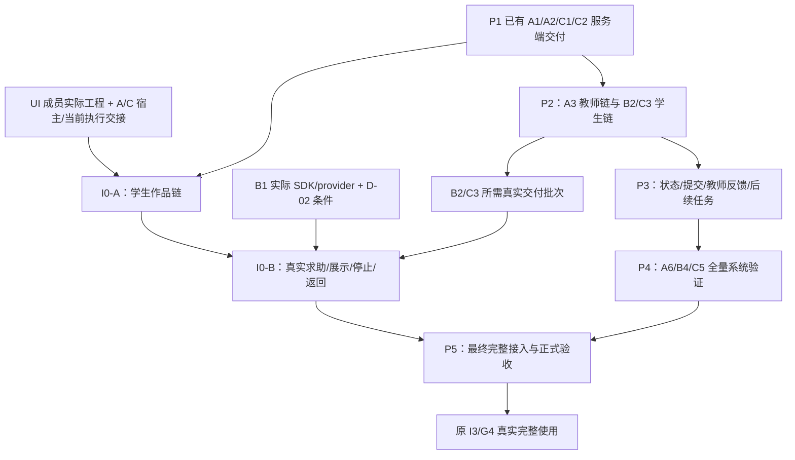

# I0：学生端最小学习闭环提前接入提案

日期：2026-10-11（Asia/Shanghai）。任务编号：I0。关联：[I0 Issue #30](https://github.com/paher-din/XunJie/issues/30)。协调沿用 A 的应用集成职责，A/B/C/UI 各自维护原负责模块。

**负责人已确定新增 I0 与 P2 并行、P5 保留完整集成及正式验收的排程方向。本文交付现状核查、任务拆分、建议文档补丁和 Issue；Issue 与提案文档发布已另获明确授权，实际记录见第 10 节。文件级基线写入及具体实施尚未授权，I0-A/I0-B 均未开发、未验收。** 本文不是替代产品基线，不能据此改变共享契约或直接启动开发。

## 1. 核查依据、范围和证据口径

已读 [AGENTS](../../AGENTS.md)、[README](../../README.md)，按顺序核对：

- [PRD](../product/PRD.md) §1/3/4/5/8/9：独立 Web、学生控制作品、就地支持、模型故障不阻止保存、数据门禁；对应 PRD-02/03/04/05/09/10。
- [MVP_SPEC](../product/MVP_SPEC.md) §1.3/2、M-02/03/04/05/09/10、§4～8：TextScope Core、版本/控制、AC-02/03/04/05/06/07/10/11/12/15/16、NFR-01～06，以及 G1～G4 原完成条件。
- [TECH_DESIGN](../product/TECH_DESIGN.md) §2～10/12：单应用与模块责任、真实会话、角色投影、ObjectRef、HTTP/作业/回执、短事务、隔离执行和恢复代际。
- [TEAM_WORK_PLAN](../planning/TEAM_WORK_PLAN.md) §2/3/5～10：P1～P5、分批交接、原 A/B/C/UI 职责及 I1/I2/I3。
- [G1 总协调](G1_OVERALL_COORDINATION.md) §1～6/17～19、[G2 总协调](G2_OVERALL_COORDINATION.md)全文；[A1](A1_FOUNDATION_ACCESS_TRANSACTION.md)、[A2](A2_TEACHER_DESIGN_VERSIONS.md)、[B1](B1_AGENT_CORE.md)、[C1](C1_ISOLATED_RUNNER.md)、[C2](C2_WORKSPACE_JOBS.md)的依据、实现/交接和较新验证章节；[工程衔接说明](../reference/ENGINEERING_HANDOFF.md)。
- GitHub A1/A2/B1/C1/C2 #10/#13/#11/#12/#14，以及 #22/#24/#26/#27、环境 #23 的完整正文及当前状态。开始核查时 B2 未见独立任务稿；本地 C3 任务稿仅有待评审方案，核查期间的并发实施变化单列第 2.3 节，公开任务入口为 [C3 #27](https://github.com/paher-din/XunJie/issues/27)。未提交的 C3 本地文件不作为团队阅读前置或本次推送内容。

源码核查覆盖 `apps/teaching/server/main.ts`、`app.ts`、`access/app.ts`、`design/application.ts`、`workspace/application.ts`、`worker.ts`、`inputs.ts`、`commands.ts`，workspace/records 契约、tutoring 核心/provider，以及 runner 与相关测试/证据入口。核对实际路由、调用关系和交付记录，不以文件名或 Issue 关闭推断产品可用。

开始时 HEAD=`c42f356b6135ca9bb00c2e3c61c3d2aae713f602`，检出分支为 `codex/c3-teaching-records`；已有未跟踪文件只有 C3 任务稿。该分支名不表示 I0 领取 C3，本任务不切分支、不覆盖/暂存/提交其他成员文件。

可写：本文。只读：AGENTS、README、product/planning/reference、G1/G2 与作者任务稿、全部应用/测试/配置。建议补丁在第 6 节，尚未应用；提案阶段未创建 Issue，后续发布按第 10 节授权执行，未发送成员消息。

## 2. 当前计划的问题和可复用能力

### 2.1 关键问题

1. P1～P4 的服务端先行、P5 首次接 UI，使登录、项目入口、确认保存、旧快照运行、消息展示/停止等用户路径的问题很晚才暴露。新增 I0 应缩短这段等待，不增加一套业务实现。
2. P1 服务端交付不等于可启动产品。默认 `npm start` 经 `server/main.ts` 只调用 `createApp`，提供健康入口，ready 为 503；已有 `createWorkspaceApp` 递进组合 design/access，但尚无正常业务宿主、worker 消费及浏览器入口交付。
3. 当前检出目录、main 的 tracked apps 文件、前端文件/构建配置搜索，只找到 `apps/teaching/package.json` 的后端工程，未见 UI 成员可运行工程。不能推断其外部工程不存在或指定其框架；须由 UI 成员交接实际仓库/固定提交、构建与启动方式、已有操作。
4. 教学链尚有真实缺口：B1 是合成核心和注入式适配，实际 SDK invoker/token counter/模型验证未交付；B2 未见 help 业务入口和真实上下文实现；C3 在开始核查时仅有待批方案，后续出现实施改动但尚无本任务可核的完成验收，见第 2.3 节。I0-B 不可用合成回答补齐。
5. 基线中的“UI 仅最后参与”和若干 G0 时点的“无源码”状态已滞后；历史通过数、当时 Open 和 G0 文档事实必须保留，只同步当前排程/状态。TECH_DESIGN 也包含“最后接入”，只改五个指定文件会留下规范冲突。

### 2.2 分层现状

下表保留开始核查时的仓库状态；核查期间 C3 的较新变化以第 2.3 节为准。“已验证”引用既有记录，本次没有新增业务或节点测试。GitHub 状态于 2026-10-11 回读。

| 能力/任务 | 已实现、可复用 | 既有验证及边界 | 等待真实接入/尚未开发 |
| --- | --- | --- | --- |
| A1 / #10 Closed | scrypt 登录/退出、当前 Session/课程、Origin/CSRF、资源归属、短事务和公共记录适配 | G1 组合 typecheck/build、授权/事务用例有记录；仅获准新合成库 | 长期账号、正常业务宿主、同源 HTTPS/TLS 与浏览器会话未交付 |
| A2 / #13 Closed | 资料/草稿、角色投影、不可变活动、分配/暂停与 CAS | 来源 A2 真实 readiness 正向联调 1/1；旧节点证据有范围 | 真实课程内容审阅、正常学生入口和 UI 投影尚未验收 |
| C1 / #12 Closed | 专用 VM/隔离作业、固定 C17 profile、原 runId 查询/取消、可信检查及只读产物 | 原 guest 48、SSH 10；非永久 ready，不能外推当前部署 | I0 环境受认证连接、当前 source/fingerprint/profile/validation/代际由 C 核实 |
| C2 / #14 Closed | 同事务文件/双键 ACK、50 文件/1 MiB、不可变快照、run/job 查询、控制、诊断、worker | 作者最新节点组合 32/32；G1 组合专项 30 通过/2 节点跳过；均是各自来源范围 | 业务宿主消费原 jobs、IndexedDB/账号切换/多标签/编辑状态/正常浏览器链未验收 |
| B1 / #11 Open | 教师/学生合成核心、有限动作、守卫、最多一次修复、3 次/45 秒和 actual/unknown usage；注入式 DeepSeek 接缝 | 组合 B1 36 项及 SDK 导入/构造 smoke；供应商调用 0 | 实际 SDK invoker、最终输入 token 上限、真实模型/语义/费用未交付 |
| B2 / #26 Open | 可复用 B1 核心、A2 固定政策、C2 受控快照/诊断接口 | 未见 B2 本次实现/验收证据 | help 接纳、真实上下文、取消/替换、实际生成及投递守卫仍待交付 |
| C3 / #27 Open | C2 公共 Job/Receipt/Event、采集控制和必要过程基础可复用 | 本地任务稿仅方案准备；C3 业务验证未执行 | 持久教学原文/Action/Delivery/展示回执、事件补取、完整教学停止/失效待交付；新 schema/共享接缝待批准 |
| UI / 业务宿主 | 后端工厂可供适配，未见前端工程 | 浏览器链未执行；后端测试客户端不计真实展示 | UI 实际交付、宿主/入口、分配发现和客户端初始化交接缺失 |
| P3/P4/P5 | 原职责与契约保持 | 无完整学习画像/教师反馈闭环/完整工程/真人验收证据 | A4/A5/B3/C4、A6/B4/C5、I1/I2/I3 继续按原任务推进 |

G1 最新 Linux 完整回归两轮为 185/192（2 失败、5 跳过）与 186/192（1 失败、5 跳过），观测约 18.7 秒墙钟跳变；Windows 稳定针对性为 59/60（1 节点跳过）。不拼接成全量通过。#23 保留根因和稳定性复验，正式试点前必须处理。

#9 和 A1/A2/C1/C2 的关闭是已确认的服务端管理收口。完整 G1 在 #22，P2 在 #24；#22/#24/#26/#27/#11/#23 均 Open。I0 不替代任何原关闭条件。

### 2.3 核查期间出现的并发实施变化

交付核对时出现其他工作项的 README、contracts/design/records、access/db/design/workspace 改动，以及未跟踪的 C3 `server/records/application.ts`、`schema.ts`、`teaching.ts`、测试和验证脚本。上述文件不是 I0 的写入，本任务全部保留，不暂存、不提交、不回退。

C3 作者稿随后记录负责人已批准其方案并开始实施，新增四表/二十六表工厂、`createTeachingRecordsApp`、问题/完成/失效接缝、events/receipts 及教学记录/覆盖读取；源码确有对应开发中实现。该授权记录属于 C3 的具体范围，不由 I0 重新申请或扩大；本任务也不把作者记录当作产品基线已同步。

最新分类应为：**C3 从“方案准备”进入“本地实施中，待验证/审查/实际 B2 联调”**。作者记录类型检查通过，但业务测试/完整回归有依赖环境阻塞，B2 正式 help/worker、真实模型、浏览器均未执行。不能据新增文件判为完整 C3 已交付或 I0-B 就绪。

本任务执行文档检查时，C3 稿引用的 `apps/teaching/tools/wsl-approved-node.sh` 尚不存在，造成全仓库文档检查失败及检查器 4 项失败；不覆盖作者稿、创建占位脚本或改变检查器来消除错误。后续 I0-B 接入包应按 C3 实际完成提交和验证重新核接口，开始核查时的 C2 工厂清单只覆盖原交付，不自动覆盖这批共享改动。

## 3. P1～P5 + I0 的依赖与并行

| 执行段 | 保留的工作 | I0 关系与退出口径 |
| --- | --- | --- |
| P1 | A1→A2、C1→C2，B1 按批次交付 | 已有服务端成果供 I0-A 复用；B1 真实接入仍续办，不要求其完成才接编辑/运行 |
| P2 | A3 教师链，B2/C3 学生链；B1 剩余接入并行 | UI 开展 I0-A；A/C 交最小宿主/作品链接入包。I0-B 等 B1/B2/C3 所需真实批次，不等整个 P2 或 A3 完成 |
| I0-A | 登录→已有分配→任务阅读→编辑/创建→确认保存→隔离运行/结果→修订重跑 | 等实际 UI、A1/A2/C1/C2 接入包和当前环境；不等 B2/C3、画像、教师复核或 P4 全量完成 |
| I0-B | I0-A + 当前代码/运行求助→实际消息展示→停止/返回→学生自主修订再运行 | 等 I0-A 通过、B1 实际 provider/D-02、B2 上下文、C3 原文/回执/取消的真实交付 |
| P3 | A4→A5、B3、C4，按原分批依赖接教师闭环 | 不作为 I0 开始前提；后续接入有效状态后补适用历史/纠正验证，不用合成画像填未知 |
| P4 | A6/B4/C5 完整权限/语义/负载/隔离/恢复交接 | 可吸收 I0 分层证据；保持原全量检查与测量口径，覆盖变化的部分重新验证 |
| P5 | I1 完整适配→I2 正式工程验收→I3 真实完整使用 | 复用 I0 工程，补全部教师/提交/反馈/后续/导出/恢复等能力，核对最终组合；保留 #22 和 G1～G4 全部出口 |



图是阶段摘要，不增加原模块之间的开工门槛：A4 可先做契约/状态逻辑，B2/C3 可按契约并行，联调按所需批次等真实交付。B1/B2 同由 B 负责，C3 和运行交接同由 C 负责，不能把同一个人的任务算成新增人力并行。A 协调最小接入批次，不把 I0 交给新角色，也不取代 A3 等原任务。

“真实接入”首先指团队实际 UI + 真实会话/持久化/独立执行/真实模型链。开发账号和内容继续合成。若要在 P5 之前安排真实学生进行限定学习路径观察，负责人须另行确认范围、告知/数据、账号/私有入口、当前隔离和稳定性条件及具体开放授权；这类阶段观察不计作完整 AC-13/14 或 G4。原 I3 进入门槛不因 I0 名称解除。

## 4. I0 的任务、责任和客观验收

下面是增量验收计划，全部未执行。I0 编号只追踪接入结果，不新增或改写产品 AC/NFR。

### 4.1 I0-A：学生作品链

| 步骤 | UI 与模块责任 | 可验收结果 |
| --- | --- | --- |
| A-0 交接/组装 | UI 提供实际工程；A 组装既有 workspace→design→access 工厂和正常入口；C 交 runner/worker 消费与恢复说明 | 固定代码/依赖/启动说明可复现，真实业务路由可访问；jobs 在宿主正常消费，学生不需维护者手工 processJob。存储/Origin/签名/节点配置均来自已获准环境 |
| A-1 登录/进入分配 | UI 接 A1 会话；A/A2 提供合法分配入口和活动投影；C 接 Attempt | 学生凭真实认证机制进入本人已分配 Core，看到任务/路线/允许帮助；刷新可恢复，GET 不激活学习；伪角色、他人/跨课程/未分配 ID 拒绝 |
| A-2 编辑/创建/保存 | UI 维护编辑、文本文件创建和本机草稿；C2 接 sync/ACK/snapshot | 可创建 `.c`/`.h` 和必要公开 ASCII 文本并编辑；ACK 前后状态清楚；保存后能回读确切文件实例/版本/hash 和不可变快照；未确认草稿不能当运行版本 |
| A-3 冲突/恢复 | UI 做账号+Attempt 隔离的本机草稿与比较；C2/A 保持 CAS/幂等/事务 | 已确认版刷新恢复；断网草稿单列，重连先处理冲突；双标签页不静默覆盖；账号切换不暴露他人草稿；同键/同 clientSeq 重试返原 ACK，异摘要拒绝 |
| A-4 运行/结果 | UI 接课程批准参数与状态；C2 固定快照/Job；C1 隔离执行；A 保持授权 | 按 Core 的 stats/find/top 和批准文件/参数发起运行；queued/running/失败/未知可辨；成功、编译失败、程序错误、依赖不可用的结果与原 snapshotId/runId 对应；学生可自主修订再保存/运行 |
| A-5 版本/取消/边界 | UI 显示运行所用版本；C 保留原 ID 对账和整个单元取消；A 核角色投影 | 运行中编辑不会改运行快照；重复请求不重跑；停止未确认时保持 cancelling/unknown；旧代际拒绝且不自动换键重做。应用/私有资产/他人代码不进入运行环境或浏览器载荷 |

I0-A 通过必须同时满足：上述正向闭环在团队实际浏览器工程执行；对应越权/CAS/原 ACK/旧快照/取消/故障反例有记录；所用节点当前 readiness/profile/validation/代际真实可核查，NFR-03 限额实际生效且无严重越权、丢失或隔离缺失。学生编辑不等待模型；模型模块未就绪也能完成本增量。

对应 M-02/03/10 和 M-09 的作品恢复部分，AC-02/03/04/10/12/15 的相关部分、NFR-01/03/04/05。I0-A 没有全部文件回收/完整检查/求助/旧备份等场景时，相关 AC 必须保持“部分验证”，完整 #22/P5 仍待执行。记录阶段延迟、错误、环境和负载；未按 10 会话/100 样本口径实测，不宣称 NFR-01 整项通过。

### 4.2 I0-B：真实辅导、消息与学生接棒

| 步骤 | UI 与模块责任 | 可验收结果 |
| --- | --- | --- |
| B-0 真实服务交接 | B 交 B1 实际 SDK/token 控制、B2 help/worker；C 交 C3 原文/Action/事件/回执/取消；A 集成 | 获准的真实 provider 调用记录可核查，输入/配置/usage/失败有版本和来源；合成传输与真实模型分别报告，schema/共享接缝需批准后才实施 |
| B-1 当前对象求助 | UI 先确认代码并传确切 ObjectRef/选区，或引用原运行；B2 经 A/C 装配上下文 | 代码、运行两类求助都可用；问题、活动/政策、快照/文件/version/hash/UTF-16 range 或 runId 可回查。无画像可求助；他人、私有资产和过时对象不能进模型 |
| B-2 实际内容与展示 | B 校验结构/引用/政策/语义；C 保存原文/Action 并投递；UI 渲染和回执 | 获准模型生成内容可回取，来源和学生原作区分；received、displayed、acknowledged 分别记录，页面可见并渲染后才报 displayed；学生明确动作才报 acknowledged；缺回执未知 |
| B-3 停止/返回 | UI 本地即时阻止迟到展示，提供实际停止/返回；B2 接 abort/替换守卫；C3 持久停止 | 生成中停止、已生成未展示停止、新帮助替换和重连竞态均不复活旧 Action；已展示事实不抹掉。相邻例子返回原作品/位置，点击“我先试试”交还操作，不自动继续生成/改代码/运行 |
| B-4 自主修订/再运行 | 学生在 UI 自行修改/保存/运行；UI 展示旧建议依据；A/B/C 保持版本 | 两类真实求助各至少完成一次“求助→实际内容→学生自主修订→新快照运行”的闭环。编辑使上下文过时时先同步/标过时，不把旧行号贴新代码；不以作品改对证明独立掌握 |
| B-5 故障/政策/记录控制 | B2 守卫与降级；C3 原文/回执/采集控制；UI 说明和状态 | 禁用帮助检查不能从入口/生成/投递绕过；暂停采集后不上传逐次过程，显式保存/求助/运行必要数据继续保存，恢复不回填。关闭提醒与主动求助独立；超时/预算/模型失败不阻止 I0-A 保存和人工操作 |

I0-B 通过必须满足：实际 UI、B1/B2/C3 真实交付链全部接通；代码和运行引用、帮助政策、原文/展示/取消/恢复反例通过；由实际教学审阅者核提示是否适切、是否保留下一步行动，严重语义问题处理后才记通过。不能用 SyntheticProvider、关键词匹配、模拟客户端回执或模型自评代签。

对应 M-04/05 和相关 M-09，AC-04/05/06/07/11/12/15/16 的接入部分、NFR-02/04/06。单轮最多 3 次、最多一次修复、含排队接受起 45 秒、每 Attempt 最多一个有效辅导 Job，换 worker 不重置。接收/排队 ≤1 秒、完整可展示结果 p95 目标 ≤20 秒和原 30 样本/10 会话口径保留；阶段少量真实调用不等于完整 NFR 或 B4 已完成。

### 4.3 实施顺序与交接产物

1. 先由指定维护者同步已授权的排程文档；A/B/C/UI 确认各自具体批次/文件/已有操作，接口差异与红线另行评审。
2. UI 与 A/C 交实际工程、宿主及作品链适配包；只补该闭环必需的调用和状态。未具备 UI 时继续接口/错误/版本交接，不建替代工程。
3. 实际浏览器执行 I0-A，缺陷回到原模块修根因；提交请求/ACK/快照/原运行引用和通过/失败/未执行清单。
4. B1/B2/C3 并行推进原任务；满足实际模型和消息/取消批次后接 I0-B，不等 A3 或 P3 全部完成。
5. I0-B 验证真实内容、版本、停止、返回及自主再运行；必要真实学生观察按第 3 节单独协调。
6. 向 #22/#24 交接证据索引与缺口，P3/P4/P5 按原条件继续；最后以最终组合核全部 M/AC/NFR，保持失败和未执行项。

交接包沿 TEAM §8.5：固定提交/代码位置、获准启动与配置条件、真实请求/响应样例、版本与状态/错误、可重复命令和实际结果、下游可用批次与待办。凭据仅通过批准通道配置，不进入文档、Issue、样例或日志。

## 5. UI 依赖和接口交接要求

### 5.1 已有接口，复用而不另造

| 提供方 | UI 所需接口/能力 | 必须交清的字段与边界 |
| --- | --- | --- |
| A1 | POST `/api/sessions`、GET `/api/session`、POST `/api/logout` | 登录只 loginName/password；身份/课程从服务端会话取得；Secure/HttpOnly cookie、同源 Origin、`x-csrf-token`。签名材料不交浏览器，不能降安全配置来接开发端口 |
| A2 | GET `/api/assignments/:id`、`/api/activities/:id`、`/api/resources/:id` | 本人分配/固定活动/获准资料；assignmentRevision/activityControlRevision 与暂停原因；学生只取 student 投影，不能读取 tutor/private 视图 |
| C2 | POST `/api/assignments/:id/attempts`；GET `/api/attempts/:id` | 返回/恢复原 Attempt、状态/作品/版本/原 Job/运行；GET 不激活。所有读取继续核当前授权 |
| C2 | POST `/api/attempts/:id/sync`、`/snapshots` | Idempotency-Key、recoveryGeneration；sync 的 expectedWorkspaceRevision/clientId/clientSeq、create clientFileKey 或 update fileId/baseVersion、正文或 UTF-16 changes；ACK 的实例映射/版本/hash/serverSeq/原回执。snapshot 冻结确认清单，不能夹带本机未同步内容 |
| C2/C1 | POST `/api/attempts/:id/runs`；GET `/api/jobs/:id`、`/api/attempts/:id/runs/:runId`；POST `/api/jobs/:id/cancel` | expectedAttemptRevision、snapshotId、runtimeProfileVersion、entryFileId、批准 operation/fileIds/参数、mode；原 runId/jobId、诊断/来源与 unknown/cancelling。只用固定 profile/argv，不接受 shell/GCC/镜像/宿主路径 |
| C2 | GET `/api/attempts/:id/snapshots/:snapshotId`；POST `/api/attempts/:id/controls` | 确切快照；position 的 route/question/returnPosition 和 expectedAttemptRevision；capture/reminders/attempt 暂停独立。过程拒收不阻塞合法作品 ACK |
| C1/C2 内部交接 | `pendingJobs` / `processJob`、受认证 submit/query/cancel/readRuntime | A 管宿主生命周期，C 管原 jobs 消费/租约/取消/恢复和连接交接；浏览器只访问授权业务 API，不接 SSH、维护入口、原始私有运行结果 |

实现/DTO 入口：[access app](../../apps/teaching/server/access/app.ts)、[design application](../../apps/teaching/server/design/application.ts)、[workspace application](../../apps/teaching/server/workspace/application.ts)、[inputs](../../apps/teaching/server/workspace/inputs.ts)、[workspace contracts](../../apps/teaching/contracts/workspace/index.ts)、[worker](../../apps/teaching/server/workspace/worker.ts)。

`createWorkspaceApp` 已组合 A2/A1，宿主应复用这一组合，不同时启动三个互不共享状态的 app。宿主必须持续消费/对账原 Job，不能只返回 queued 或让维护者手动推进学生操作。GET workspace 已有授权诊断投影，运行结果 UI 不能绕过它读取私有 CheckResult/hash。

### 5.2 尚需具体交接，不能当作现成 API

- **分配发现与初始化（A/UI）：** 现有 GET assignment 需要已知 ID；未见本人分配列表路由，GET session 仅给课程/身份/CSRF。优先核实际 UI 是否已有教师提供的合法分配链接/进入动作；若不能正常找到项目，由 A/UI 记录缺口并提出最小读取接口，确认后实施。不能由 UI 硬编码他人 ID 或要求维护者在学生流程中补状态。
- **恢复代际（A/C/UI）：** 变更 DTO 要求 recoveryGeneration，空 Attempt/尚无 Job 时当前 API 未见完整初始化交接。A/C 须交受信当前代际的获准读取/初始化方式；不能用旧验收字符串、客户端随机值或从错误里猜。缺项属于接入阻塞，任何新增公开契约先提案。
- **B2：** 正式 help 路由已在 TECH 约定，当前无实现。交清问题/ObjectRef、固定政策、最小可信上下文/获准引用、空状态、配置/用量、替换/停止/完成守卫，以及正常宿主 worker 装配。`generateStudentHelp` 本身不是 HTTP 业务入口。
- **C3：** TECH 约定 events/receipts/cancel，核查期间新增的本地实现尚待完整验证/审查/联调。交实际原文与内容 hash/版本、actionId/clientReceiptId、目标客户端校验、角色裁剪事件/游标、重连先同步控制/epoch/代际、持久取消与迟到事实。具体 Message/Delivery DTO 仍以评审后真实交付为准。
- **C3 授权边界：** 作者稿已追加四表/二十六表新合成库及共享接缝的具体批准记录，原“待批”保留其准备时点。I0 不重新请求同一批准、不采用任务稿替代正式基线，也不把该授权扩展到 I0 的新增契约、旧库/生产迁移或其他操作。

所有新增字段/错误码/状态/权限/事务差异仍由 A 汇总 B/C/UI 提案，经负责人确认，再由获授权维护者同步 TECH 和受影响验收。I0 本轮没有接口或 schema 变更提案批准。

## 6. 文件清单与逐项建议 diff

**以下只建议、不应用。** 采用定位后的段内文本替换或插入 diff，保留原 Markdown 链接和未列出内容；这些片段不是可直接 `git apply` 的完整补丁。授权维护者写入时须先核目标仍匹配、先改规范再改实践，并验证原 M/AC/NFR/G1～G4 条件和历史表原文不变。

| 文件 | 准确范围 | 状态 |
| --- | --- | --- |
| `AGENTS.md` | 已确认决定追加 2026-10-11 I0；目录约定中 TEAM 的接入时点；任务范围中滞后的 G0 当前阶段句 | 待文件/范围授权；权限表、学生边界和红线不改 |
| `docs/planning/TEAM_WORK_PLAN.md` | §1 排程句、§3 总表/依赖图与新增 §3.2、§6 学生界面交接句、§8 增量证据说明、§9 标题/开头/I1/P5 最终职责、当前阶段说明与追加维护记录 | 待授权；不重写 A/B/C 任务卡或验收矩阵/数值，不重分职责 |
| `docs/product/MVP_SPEC.md` | 仅 §8 的执行顺序解释两段与 I0 补充 | 待授权；M-01～10、AC/NFR、G0～G4 表、§7 完成定义及 §10 历史原文保持 |
| `README.md` | 开头追加当前排程/状态；文档导航的分工说明/新增 I0 行；“安排开发时”当前顺序段 | 本轮也不写；批准上述文档后同步，不刷新旧验证数 |
| `docs/tasks/I0_STUDENT_VERTICAL_SLICE.md` | 本文：核查/依赖/接口/验收/风险、建议 diff、Issue 草稿及真实验证结果 | 本次新建的唯一文件 |
| `docs/product/TECH_DESIGN.md`（额外一致性提案） | 仅 §3.3 追加排程同步段，说明 §2/8.4/12 等“最后接入”指最终完整接入 | 额外单列待授权；不改架构/接口/数据模型/依赖/安全边界 |

PRD、reference、G1 历史不需修改。G2/C3 等作者稿中旧“UI 最后”属于原排程/时点，由对应主责在新方案批准后追加交接记录；不由 I0 覆盖它们。若原 Issue 的现行执行句仍会阻塞 I0，再按第 7 节请求具体范围的关联更新。

### 6.1 AGENTS.md

在“已确认的产品与协作决定”中保留 2026-10-08 原决定，追加：

```diff
+ - 2026-10-11：新增 I0 学生端最小学习闭环，与 P2 并行；UI 成员在 I0 阶段按实际工程提前参与接入。I0-A 为登录/已有分配/编辑/保存/隔离运行，I0-B 增加真实上下文求助/消息展示/停止与返回。P5 继续负责最终完整 UI 集成和正式验收；A/B/C/UI 职责、产品范围、共享技术契约和 G0～G4 完成条件不变。具体依赖与增量证据见 TEAM_WORK_PLAN 和 I0 任务文档，任务建立不自动授权实现或红线操作。
```

目录约定中 TEAM 说明的尾句精确替换：

```diff
- 实际界面接入仅在最后阶段列出。
+ 实际界面按 I0 提前接入学生最小闭环，P5 完成最终完整接入与正式验收。
```

“任务范围”中的当前阶段句精确替换，其他边界保持：

```diff
- 当前 G0 仍处于评审准备，任务建立不授权大规模实现。
+ 当前已进入 P2，新增 I0 的具体实施仍须核已批准方案、真实上游与文件范围；任务建立不授权大规模实现。
```

### 6.2 TEAM_WORK_PLAN.md

§1 当前排程句替换；原切片完成条件句保留：

```diff
- 原 G1～G3 的服务端部分先预交付，实际界面接入统一放在最后。
+ 原 G1～G3 的服务端部分先预交付；I0 与 P2 并行，按实际 UI 提前接入学生最小闭环，P5 负责最终完整接入与正式验收。
```

§3 总表在 P2 后新增一行，P5 末列替换，A/B/C 的 P1～P4 单元格不动：

```diff
+ | I0：学生最小闭环（与 P2 并行） | A1/A2 交接与最小业务宿主集成，沿原 A 职责 | B1/B2 真实 provider、上下文与辅导交接（I0-B） | C1/C2 作品/运行，C3 原文/回执/取消交接（I0-B） | UI 沿实际工程接入 I0-A→I0-B；不取代完整 G1/G2/P5 |
- 完成实际界面验收，再进行真实试用
+ 完成最终完整接入、正式浏览器/工程验收，再按 I3 进行真实完整试用
```

§3.1 图保留原边，新增支路；最终节点文字改为“最终完整实际界面接入、浏览器验收与真实试用”。下面 IA/IB/UI 只表示接入增量和 UI 交付，不新增人员职责：

```diff
+     A1 --> IA["I0-A：学生作品链"]
+     A2 --> IA
+     C1 --> IA
+     C2 --> IA
+     UI["团队实际 UI 与业务宿主接入包"] --> IA
+     IA --> IB["I0-B：真实辅导与消息展示"]
+     B1 --> IB
+     B2 --> IB
+     C3 --> IB
+     IB --> I
```

在 §3.1 后、§4 前新增：

```diff
+ ### 3.2 I0：学生端最小学习闭环提前接入
+
+ I0 与 P2 并行，沿用 A/B/C/UI 职责。UI 维护实际工程及交互，A 负责身份/活动/公共入口与应用集成，B 负责模型/上下文/辅导，C 负责作品/执行/原文/事件/回执/取消。按所需批次交接，不互等完整任务或将同一成员的任务视为新增人力并行。
+
+ I0-A 接登录、本人已有分配和任务、C/头文件/必要 ASCII 文本编辑与创建、确认保存、固定快照隔离运行及结果、学生自主修订重跑。前置为实际 UI、A1/A2/C1/C2 接入包、获准业务宿主与当前执行就绪；不等待 B2/C3 或 P4 全量交付。
+
+ I0-B 在 I0-A 通过后接当前代码/运行引用求助、实际教学消息展示、停止/返回与自主修订重跑。等待 B1 实际 provider 与 D-02 条件、B2 真实上下文及 C3 原文/回执/持久取消；不以合成 provider 算真实接入，不等待画像或完整教师反馈闭环。
+
+ 依赖/接口/增量验收与阻塞详细记录在 docs/tasks/I0_STUDENT_VERTICAL_SLICE.md。未交 UI、宿主、初始化读取或真实模型时分别标阻塞。浏览器工程、实际模型、真人观察分层报告；任何提前真人观察另核实际数据/入口/隔离/稳定性及具体开放授权，不自动满足 I3/AC-13/14。
+
+ I0 是排程增量，原 M/AC/NFR、G1～G4 和 P3/P4/P5 完成条件保持。P5 的 I1/I2/I3 复用 I0 工程和可追溯证据，补全部未覆盖场景并核最终组合，不因 I0 通过关闭 #22/#24/#26/#27。
```

§6 “P2 的并行和交接”末句精确替换：

```diff
- 消息展示、停止交互、例子返回和采集开关的实际界面检查留到最后。
+ 消息展示、停止交互、例子返回和采集开关的学生切片检查可在 I0-B 提前完成；完整 G2 和最终组合验收仍按 P5 保留。
```

§8.2 前追加一个统一解释段，避免重写 §8.2～8.4 的责任矩阵和阈值：

```diff
+ 以下矩阵中“最后/最终接入”指完整场景及最终组合验收。I0-A/B 可以提前验证其实际覆盖的学生操作、前端载荷、版本、展示/控制和恢复；报告具体覆盖与未执行项，P5 补全并核最终组合。原主责、样本量、数值和通过条件保持。
```

§9 标题、开头及 I1 的前提描述精确替换：

```diff
- P5：最后接入实际 UI，再完成 G4 真实试用
+ P5：最终完整接入实际 UI，完成正式验收与 G4 真实试用
- UI 成员只在本节加入分工。
+ UI 成员已在 I0 提前参与学生切片，本节完成最终完整集成与正式验收。
- A6/B4/C5 的接入包齐备；UI 成员交付可运行的实际工程、构建说明和已有操作。
+ A6/B4/C5 的完整接入包齐备；团队实际 UI 可运行，I0 已接入的能力及其余教师/反馈/后续等操作、构建说明和缺口一并交接。
```

I1 原 A/B/C/UI 分工和 I2/I3 原门槛保留。I1 交付说明追加“复用 I0 工程；核新增/变化能力和最终组合，按覆盖与版本引用阶段证据”；不因早期通过免除未执行或受影响场景。

当前状态同步只处理当前句和追加日期，不改历史维护表：文件头“仓库无正式应用代码，环境/业务/浏览器验收未执行”替为“P1 服务端已有交付，P2 已进入；完整应用/浏览器验收未完成，I0 接入未开始”；§2 的“仍无正式源码，模块名不代表已实现”替为“模块的实际实现与分层验证状态以对应任务记录为准”。§10.1 原 G0 状态表注明其 2026-10-09 时点并保留，追加 2026-10-11 当前行“I0-A→I0-B：仅提案，等待文件级同步与实际交接”；§10.3 追加本次授权后真实维护记录，不提前填检查通过或同步日期。

### 6.3 MVP_SPEC.md

仅 §8 实施顺序：第一段内排程文本精确替换，原链接及后续完整退出条件句保持：

```diff
- 实际 UI 接入统一放在最后
+ 新增 I0 与 P2 并行，按实际 UI 提前接入学生最小闭环，P5 保留最终完整集成与正式验收
- UI 成员仅在最终接入阶段参与该分工，不要求其前期交付作为三人核心开发的前提。
+ UI 成员在 I0 和 P5 参与实际接入；UI 交付是 I0 浏览器联调的前置，不作为无关服务端/Agent 开发的前置。
```

第三段中接入时点替换：

```diff
- 在最终接入阶段收到成员交付后核对实际操作与数据需求
+ 在 I0 与 P5 按成员实际交付分别核对学生切片与完整应用的操作、数据需求
```

在第三段后补充实施解释，G0～G4 表不增新门禁行：

```diff
+ I0-A 接学生登录、本人已有分配、任务阅读、代码/文件编辑创建、确认保存及隔离运行，依赖 A1/A2/C1/C2 与实际 UI/业务宿主，不等待 B2/C3。I0-B 在 I0-A 基础上接真实上下文求助、消息展示、停止与返回，等待 B1 实际模型条件及 B2/C3 的真实交付；空学习状态不阻塞求助。I0 不要求先完成全部画像、教师复核或反馈闭环。
+
+ 本排程也适用于第 1.3 节“实际 UI 最后接入”的执行时点说明：I0 提前接学生局部，P5 完成最终完整接入。I0 的增量结果与服务端、实际模型、浏览器及真人结果分别记录，不改变 M-01～M-10、AC、NFR、第 7 节完成定义或本表 G1～G4 出口；尚未覆盖场景继续未执行，正式试点仍按原门禁。
```

### 6.4 README.md

批准并同步规范/共同计划后，在开头 P2 当前状态后追加：

```diff
+ 2026-10-11，项目负责人确定新增 I0 学生端最小学习闭环，与 P2 并行：I0-A 先接登录/已有项目/编辑/保存/隔离运行，I0-B 待 B1 实际模型条件及 B2/C3 真实交付后接求助/展示/停止与返回。P5 保留最终完整 UI 集成和正式验收，原产品范围、A/B/C/UI 职责与 M/AC/NFR/G1～G4 条件不变。
+
+ 当前 I0 仅完成核查和任务提案，实际接入/浏览器验收未执行。仓库未见 UI 成员可运行工程，默认 npm start 仍为健康入口，业务宿主待 A/C 组装；真实模型及 B2/C3 学生链尚未交付。#22/#24/#26/#27/#11/#23 继续按原范围跟踪，服务端预交付不计完整产品通过。
```

文档导航：分工行末说明替换，新增 I0 导航行；由维护者沿 README 原链接格式添加 `docs/tasks/I0_STUDENT_VERTICAL_SLICE.md` 的仓库相对入口：

```diff
- UI 成员仅在最终接入阶段参与
+ UI 成员在 I0 学生切片与 P5 最终完整接入阶段参与
+ | I0 学生最小学习闭环 | P2 并行接入、I0-A/I0-B 依赖/接口/增量验收、阻塞和剩余正式验收 |
```

“安排开发时”当前顺序段内精确替换：

```diff
- 三人先按业务契约完成后台、Agent 与执行能力，再在最后接入团队实际 UI。
+ 三人按原业务契约推进后台、Agent 与执行能力；UI 在 I0 与 P2 并行接入学生最小闭环，P5 完成最终完整集成和正式验收。
```

旧日期的合并/测试/未执行记录保留；若 README 当前段落沿用“最后接入”，由新增当前排程段明确只指完整接入。I0 真正启动后才追加获准启动/使用/验证命令，不预先声称可运行。

### 6.5 TECH_DESIGN.md：额外必要的一致性同步

§3.3 保留 2026-10-08 历史排程段，后面仅追加：

```diff
+ 2026-10-11 排程更新：学生最小闭环按 I0 与 P2 并行提前接入团队实际 UI，P5 负责最终完整集成与正式验收，具体增量/依赖见 TEAM_WORK_PLAN 与 I0 任务文档。本文件第 2、3.3、8.4、12 节等“UI 最后接入/交付”表述按此执行顺序理解；前端沿实际工程，模块责任、技术栈、接口、数据模型、权限、版本、幂等、隔离/取消和 G1～G4 验收语义不变。当前实现/验证状态以带日期的任务记录为准，旧 G0 未实施记录保持其时点。
```

这项是文档一致性需求，不是重选架构或补写契约；没有该文件级授权时继续只记录差异。

## 7. GitHub Issue 建议与依赖链接

建议只建一个 I0 Issue，标题：**[I0/P2] 学生端最小学习闭环提前接入（I0-A / I0-B）**。以下保留发布前方案，提案阶段未创建或预占编号；后续已发布 #30，实际正文与回读见第 10 节，不设置未知 assignee、不关闭其他 Issue。

建议正文如下，可在批准后的任务文档进入远端仓库后加其公开链接：

> 项目负责人已确定 I0 与 P2 并行，P5 保留最终完整接入及正式验收。本任务沿 A/B/C/UI 原职责，接团队实际 UI 的 TextScope Core 学生切片；不创建替代工程、不调整技术栈/共享契约或降低原 M/AC/NFR/G1～G4。
>
> I0-A：真实认证机制登录→本人已有分配和任务→C/头文件及必要文本编辑/创建→确认保存/不可变快照→隔离运行/结果→学生自主修订重跑。依赖 A1/A2/C1/C2 的实际交接、UI 工程、业务宿主和当前执行环境；不等待 B2/C3。
>
> I0-B：I0-A + 当前代码/运行引用求助→实际模型教学内容/消息展示→停止/返回→学生自主修订再运行。依赖 B1 实际 provider/D-02、B2 上下文和 C3 原文/回执/取消；无画像可求助，合成 provider 不计真实接入。
>
> UI 维护实际前端、草稿/版本/展示/停止/返回；A 负责应用集成、身份/活动/公共接缝；B 负责真实模型/上下文/教学策略；C 负责作品/隔离运行/Job/原文/回执/取消。各人修复原模块，按所需批次交接，不新增人员或互等整张任务卡。
>
> 当前 UI 工程未见入库、默认 npm start 仅健康入口、真实模型/B2 未交付；C3 已出现本地实施改动，尚待验证/审查和实际联调。先核完成交付再开始对应联调，不靠后台补学生状态；C3 既有具体批准不扩展为 I0 新操作授权。
>
> - [ ] 文件级排程同步及具体实施范围已获确认；实际 UI/宿主/接口/初始化/环境交接明确。
> - [ ] I0-A 实际浏览器正向链及权限/冲突/幂等/旧快照/取消/恢复反例通过，失败/未覆盖项有记录。
> - [ ] I0-B 实际模型、真实上下文、原文/回执/停止/返回和自主修订链通过，语义由实际审阅者复核；合成/实际模型/浏览器/真人分层报告。
> - [ ] 数据/账号/私有入口/节点/稳定性与 D-02/D-03 进入条件按具体操作落实；提前真人观察另获限定开放授权，不代替 I3/AC-13/14。
> - [ ] 接入代码、必要测试、任务文档、证据索引和未完成清单一致；向 #22/#24 交接，原验收条件未勾成通过。
>
> 关联完整 G1/P5 #22、P2 协调 #24、B2 #26、C3 #27；B1 #11 与环境 #23 是各自真实进入条件。任务完成只表示 I0 增量完成，不关闭或替代原任务。schema/迁移、凭据/.env/CI、删除、节点/部署变更、真实数据发送/付费、公开发布均按原授权边界处理。

依赖和证据回链：

| 关联 | 作用 | 是否阻塞 I0-A / I0-B |
| --- | --- | --- |
| [#22 完整 G1/P5](https://github.com/paher-din/XunJie/issues/22) | 接收 I0 增量证据和未覆盖清单，保留完整作品链与 NFR 条件 | 不是整张完成的前置；I0 不关闭 #22 |
| [#24 P2 总协调](https://github.com/paher-din/XunJie/issues/24) | 协调两条链、真实批次及共享接缝，追加 I0 关联 | 不等完整 P2；教师链继续独立推进 |
| [#26 B2](https://github.com/paher-din/XunJie/issues/26) | help、真实上下文/政策/取消/投递守卫 | A 不依赖；B 等实际所需批次 |
| [#27 C3](https://github.com/paher-din/XunJie/issues/27) | 原文/Action/事件/回执/持久取消与采集 | A 不依赖；B 等实际所需批次完成验证/审查与授权范围交接 |
| [#11 B1](https://github.com/paher-din/XunJie/issues/11) | 实际 SDK/invoker/token 上限/模型与 D-02 | A 不依赖；B 必须具备实际能力，不必等 B4 全量收尾 |
| [#23 稳定性](https://github.com/paher-din/XunJie/issues/23) | 墙钟/认证/限流/租约根因与复验 | 工程在获准稳定环境继续；正式试点前完成要求不能跳过 |
| [A1 #10](https://github.com/paher-din/XunJie/issues/10)、[A2 #13](https://github.com/paher-din/XunJie/issues/13)、[C1 #12](https://github.com/paher-din/XunJie/issues/12)、[C2 #14](https://github.com/paher-din/XunJie/issues/14) | 复用已关闭的服务端交付与接口来源 | A/B 都依赖实际接入包与当前环境，不因 Closed 假定正常 UI 宿主已可用 |

新 Issue 建立后建议只在 #22/#24/#26/#27 添加关联/当前交接备注，不改原未完成列表和关闭条件。#22 现行“P4 包齐再接入”注明仅为 P5 最终接入；#24/#26/#27 当前“UI 留最后”注明学生子集移到 I0。是否编辑正文或由授权角色追加评论，在发布授权中明确；本轮不进行外部写入。

## 8. 仍需负责人授权或协调的事项

| 事项 | 原因/影响 | 所需决定或交付 |
| --- | --- | --- |
| 基线文档写入 | 原 AGENTS/TEAM/MVP/TECH 排程与 I0 冲突，必须先改规范 | 对第 6 节逐文件/准确范围授权，并指定维护者；PRD 与历史不改。TECH 的额外段需单列授权 |
| 实际 UI 工程 | 当前仓库未见，无法建立真实浏览器验收入口 | UI 成员交可运行工程/固定提交/构建与启动/已有操作；负责人协调交付位置与接入边界，不更换框架或另建 UI |
| 最小业务宿主 | 工厂尚未组装，登录/运行不是正常启动路径 | A 提交具体宿主/初始化/同源入口方案，C 交原 Job 消费/runner/恢复代际；批准后实施，所需环境/数据库/凭据操作分别授权 |
| 学生入口/初始化缺口 | assignmentId 和空 Attempt 的 current generation 交接不完整 | A/C/UI 核实际工程可用入口；必要最小接口差异先提出并确认，不能在 I0 静默新建契约 |
| B1/B2/C3 真实能力 | I0-B 必需，尚无完整真实链交付 | B 补实际 SDK/token 控制/D-02与 B2；C3 沿作者记录的具体批准完成实现、验证/审查和实际交接，不重复申请既有范围。选择模型的既有批准不等于凭据/付费/数据批准 |
| 真实学生提前观察 | 真实学习数据和运行不可由排程名授权 | 明确是否需要、限定范围、课程/数据告知/人员/账号/私有入口、安全及稳定性进入条件；工程可先合成，I3/正式验收仍保留 |
| 当前执行/稳定性 | 历史通过不能给新部署永久 ready，#23 仍 Open | C 交当前受认证 readiness 与获准环境；A/C 跟踪 #23，修改节点/时间/网络/部署前提出具体风险与授权 |
| Issue 发布/关联更新 | 提案后负责人明确授权发布 Issue 并推送本次文档 | 已创建 #30，文档发布按第 10 节记录；在新 Issue 内关联原任务，原 Issue 正文/评论/状态未改。进一步原任务关联编辑仍需明确范围，不因 I0 关闭 #22/#24/#26/#27 |

排程方向已经确定，不再要求重选 I0。待决定的是准确文件写入、具体实施/实际交付、缺口契约及需要的外部/环境操作。本轮不笼统请求所有红线授权。

主要风险：UI 或宿主缺失会使“提前接入”停留在服务端测试；B1/C3 真实交付不足会阻塞 I0-B；为赶进度用替身、后台补状态、客户端信任或旧 ready 会产生错误验收和数据/权限风险。并发共享改动需以实际完成批次重新核接缝，按原契约和分层证据处理，不增加新平台或重复实现。

## 9. 规划提案阶段的验证、交付状态与后续

本次只核查文档/源码/Issue 并建立提案；不重新运行数据库、runner、模型或学生会话。历史验证按第 2 节来源与范围引用。

| 检查 | 状态 |
| --- | --- |
| `node tools/a0-review/check.mjs` | 失败：当次扫描 33 份文档、444 处内部引用、27 条正式变更路由；唯一报错为 C3 文档引用缺失 `apps/teaching/tools/wsl-approved-node.sh`，I0 文档无链接错误 |
| `node --test tools/a0-review/check.test.mjs` | 16 项中 12 通过、4 失败、0 跳过；四项同受上述 C3 缺失引用影响。不记全仓库检查通过，不修改他人文件或检查器 |
| Node 内联只读断言 | 通过：13 个 diff 删除目标在对应原文件均唯一匹配；原依赖图加 I0 的 40 条边无环；I0 链接错误 0、尾随空白/末尾换行通过 |
| 只读文件摘要与 Git 范围 | AGENTS、PRD/MVP/TECH、TEAM、G1/G2 共 7 份 SHA-256 与开始核查时完全一致，因此原 M/AC/NFR/G1～G4 和历史未变；I0 唯一写入本文。README/C3/共享代码并发变化单列第 2.3 节，不声称它们全程未变 |
| `git diff --check` | 通过；新增 I0 文件另作空白/末尾换行检查通过。未跟踪文件不计入 Git 默认 diff，故没有只依赖该命令判定新文档有效 |
| I0-A/I0-B 业务、真实模型、当前节点、浏览器、真人、NFR/备份恢复 | 未执行；本轮未启动实现或环境操作 |
| 受保护基线、README、GitHub Issue、提交/推送 | 未写入、未创建/修改、未提交/推送；基线排程待授权维护者同步 |

交付仅为规划变更提案。下一步由负责人对第 6 节范围指定维护者并授权同步，协调实际 UI/宿主和各模块所需批次，再分别确认具体实施；I0 独立记录增量证据，完整产品条件继续留在原任务。

本机 Node v24.15.0 仅用于文档/只读断言，未用它运行需批准 Node 24.21.0 的应用测试。纯规划工作未安装依赖、创建数据库、维护执行节点、调用模型或进行浏览器/真人验收；全仓库静态失败需由 C3 主责处理其缺失引用后再核，不阻止交付本提案及 I0 本身通过的静态核查。

## 10. 2026-10-11 Issue 发布与提案文档推送

项目负责人在提案交付后明确指示“那就发布issue吧，并推送这次的文档吧”，授权创建 I0 Issue 和提交、普通推送本文。授权不包含第 6 节受保护基线补丁、代码开发、他人改动发布、原 Issue 修改/关闭或其他红线操作；排程提案与具体实施批准分别记录。

发布前回读远端 main 为 `c42f356b6135ca9bb00c2e3c61c3d2aae713f602`，未发现 I0 重复任务。主工作副本保留 C3/共享代码、README 和未跟踪文件；发布使用基于 origin/main 的隔离工作树，提交文件只含本文，主副本的分支/HEAD 不因本次发布切换或推进。

GitHub 连接器 create_issue 返回 403（Resource not accessible by integration），未改变权限或凭据；随后使用已登录的 `gh issue create --body-file` 创建 [#30](https://github.com/paher-din/XunJie/issues/30)。正文列出 I0-A/I0-B、原职责、真实批次/阻塞、分层验收和未完成清单，关联 #22/#24/#26/#27 及 #11/#23、原 A1/A2/C1/C2；任务发布不自动授权实施或修改基线。

正文/状态回读、隔离树文档检查、唯一文件范围、普通推送与远端正文核验按实际完成后追加；未提前登记通过。发布记录不改变第 9 节在主工作副本执行时的历史失败。

已回读 #30：标题和完整正文与发布文件逐字一致，state=open，无 assignee、无已勾选任务、0 评论；新任务完整关联原任务，只写新 Issue，原 Issue 正文/状态/评论未改。

发布树仅包含 main 已提交内容与本文，不带未提交的 C3 本地稿/代码。本文的 C3 团队入口改为公开 #27，避免发布文档依赖未入库文件；主副本 C3 内容不修改。隔离树文档检查通过：32 份文档、406 处内部引用、27 条正式变更路由，errors=[]；检查器 16/16 通过、0 失败/跳过。该通过只对应发布树，不改写主副本第 9 节的 C3 缺失引用失败，也不计业务/浏览器验收。
